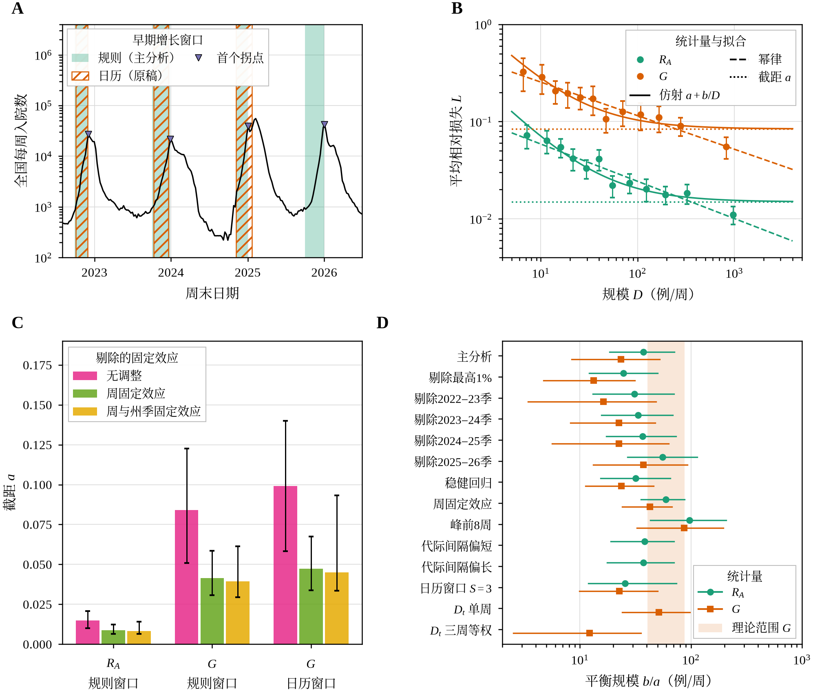
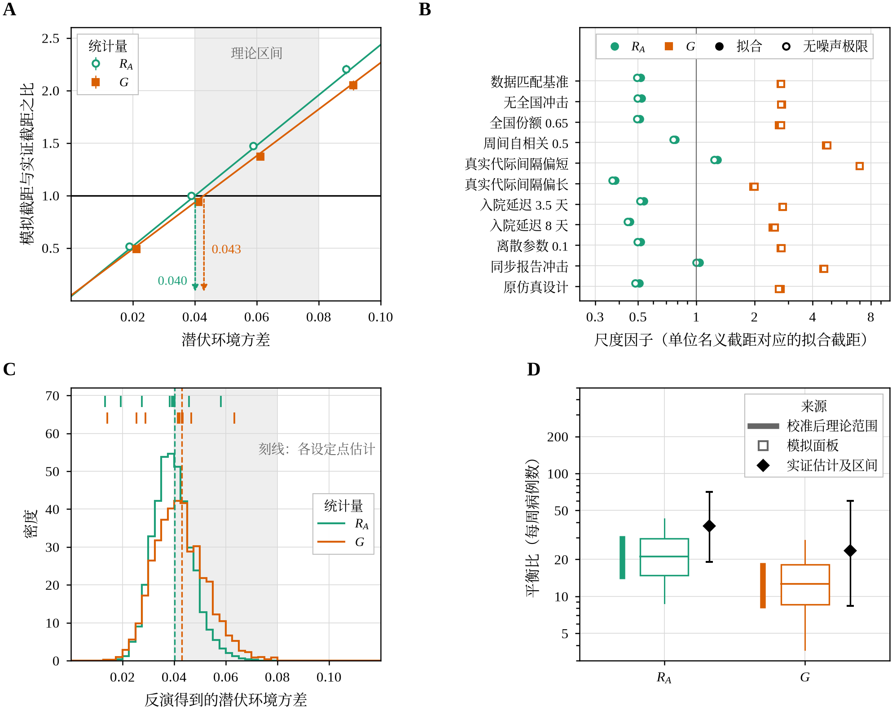
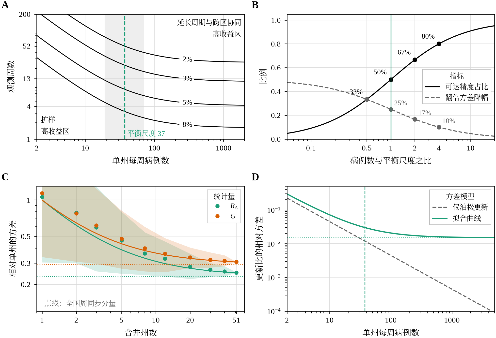

# 1 执行摘要

本任务的研究对象是一篇关于再生数估计精度的论文。论文的核心命题是：每期报告 m 例时，单期平均再生数的误差方差为 V(m) = vR + A/m，其中 vR 为再生数的跨期环境方差；病例数超过平衡规模 m× = A/vR 之后，增加病例带来的精度收益递减。实证部分使用美国 NHSN 每周流感住院数据。

任务分两个阶段完成。第一阶段完成现稿评审、补充实验、中英文新稿与第二轮评审。第二阶段是继续追问：用户要求把新稿从防御性叙事改为积极立论，评分进入 8.5–9.5 区间，语义自然，并以 .md 交付评审。本报告是第二阶段计划结束时的汇总，不含新的研究或计算，全部数字回查自 `results.json`、核查脚本输出与已发布稿件。

核心结论如下。

- **评分达到目标区间下沿。** 四次评审依次为 4/10、6/10、7.5/10 与 8.5/10，均使用同一 1–10 尺度。8.5 分的含义是剩余意见全部属于编辑性质，没有一项会改变已陈述的结果。这些评审均为任务内的内部评审，投稿前仍需外部评审。
- **两步反演把第二轮的最大缺陷转为主要结果。** 第二轮评审指出仿真校准已估计却未使用。第三轮用数据匹配模拟建立校准线，把两种表观统计量的经验截距映射为潜伏环境方差：更新型比值 RA 为 0.040 [0.026, 0.056]，加权增长比 G 为 0.043 [0.025, 0.064]，两者比值 0.93，90% 区间 0.81–1.13 落在 0.80–1.25 等效带内。
- **积极叙事设有证据护栏。** 用户方案中不受数据支持的说法没有采用，包括“完美对齐”“严密包容”“首次”“普适”“证明”。校准后的理论 b/a 范围不包含两个实证点估计，这一事实在论文中如实写出，并给出两种经过模拟检验的解释。
- **报告制度的结论限定为观察性关联。** 强制报告期机构完整度只解释截距的 2.0%（单侧上界 5.3%）。2024 年自愿报告期增长离散度为 2023 年同期的 1.58 倍，95% 区间 0.95–2.23 含 1。终稿只写“较高的机构参与度与较低的波动相伴”。
- **两版论文均已重新发布。** 英文终修稿 25 页，中文终修稿 26 页，标题换用尺度极限题眼，两版数字逐项一致。中文稿严格字体门因缺授权 SimSun 未过，相关步骤如实标为部分完成。

# 2 任务要求与完成状态

表 1 按用户要求清单逐项列出落实状态。状态依据清单记录与产物核对，不采信步骤自述。

表 1 用户要求的落实状态

| 编号 | 要求 | 状态 | 证据或缺口 |
|---|---|---|---|
| R1 | 严格评审现稿，含五部分与评分 | 已完成 | `review_original.md`，大修 4/10 |
| R2 | 评审存为 Markdown 交付 | 已完成 | 三篇评审均为 .md，Markdown 门与地名门退出 0 |
| R3 | 参照 main.pdf 重写新稿 | 已完成 | 按风格画像 25 条规则成稿，节序与图注规范对齐范文 |
| R4 | 新稿中英两版 | 部分完成 | 两版均已发布；中文严格字体门 2 项未过（无授权 SimSun） |
| R5 | 现稿与新稿各一篇评审 | 已完成 | `review_revised.md`，大修 6/10 |
| R6 | 评审中英双语 | 已完成 | 三篇评审均含英文 Part A 与中文 Part B，编号与评分一致 |
| R7 | 必要时换数据重做实验 | 已完成 | 不换主数据集，理由见 `data_decision.md` |
| R8 | 读取并体现附件 main.pdf | 已完成 | 风格画像 11 节；附件按不可信输入只作数据读取 |
| R9 | 按积极立论方案重构论文 | 已完成 | 两步反演、多尺度分解、报告制度、收益递减、文献定位、措辞清扫 |
| R10 | 换用 Scaling limits 标题并重写摘要 | 已完成 | 中英标题已换；英文摘要 256 词，超 250 词上限 6 词 |
| R11 | 反演图与设计查对图 | 已完成 | 图 3 反演图与图 6 设计查对图，中英各一套 |
| R12 | 中英两版同步修订并重新发布 | 已完成 | EN 25 页、ZH 26 页，各门 0 error（中文字体门除外） |
| R13 | 作者、机构、基金、CRediT 由用户自补 | 留给用户 | 稿件保留占位，未编造任何信息 |
| R14 | 修订后评分进入 8.5–9.5 | 已完成（下沿） | 终修核查 8.5/10；未到 9 的原因见第 3 节 |
| R15 | 第三轮评审存为 .md 交付 | 已完成 | `review_round3.md`，含终修核查附录 |

第二阶段计划共五个工作步骤。反演与补充分析、英文稿重构、第三轮评审三步为完成；中文稿同步重构与按评审终修两步为部分完成，原因分别是中文字体门，以及英文摘要字数、正文篇幅、标题措辞和信度校正四项编辑性遗留。两次重规划确认已有产物可交付后继续执行。

# 3 评分轨迹与评审结论

表 2 汇总四次评审。尺度在第一轮评审中定义，此后各轮沿用：6 分表示仍有问题可能改变主要结论，7–8 分表示没有遗留问题改变已陈述的实证结果、但框架表述在关键位置超出证据，8.5 分表示剩余意见均为编辑性，9 分以上还需要反演的外部支持。

表 2 四次评审的结论与主要扣分点

| 评审对象 | 结论与评分 | 决定分数的主要因素 |
|---|---|---|
| 用户现稿 | 大修 4/10 | 新颖性定位不足；统计量与再生数存在概念差距；截距约一半为全国周成分；区间忽略同周相关 |
| 第一版新稿 | 大修 6/10 | 仿真校准已估计却未使用（N1）；标题中“不可约”夸大；与 Parag 等工作对照不全 |
| 第三轮重构稿 | 小修 7.5/10 | N1 已实质解决；政策句超出报告证据（P1）；一致性被写成验证（P2）；vR 的条件未入摘要（P3）；尺度混用（P4） |
| 终修稿 | 小修（仅编辑性）8.5/10 | 第三轮最小改动清单五项全部完成；剩余为摘要字数、篇幅、标题与可选信度校正 |

第三轮评审第 7 节给出了达到 8.5 分的最小改动清单，终修步骤逐项完成，评审在第 11 节逐条核查并给出证据位置。核查脚本把 94 个头条数字在中英两版中逐一检出，0 项失败；终修新增的 39 个数字在两版中均存在。

未到 9 分的原因是一项具体的证据缺口：论文没有潜伏环境方差的独立外部估计。终修已用外部序列间隔文献约束代际间隔，但 vR 的水平仍随代际间隔在 0.026–0.063 之间变化。补上一项含显式住院延迟与外部代际间隔的更新方程估计，或引入第二个监测系统，是越过 9 分的必要条件。

# 4 第三轮的实证依据

## 4.1 实证基线

主分析沿用 2026-10-20 版 NHSN 数据，分析面板 10,506 个州周（原始 21,641 行），在四个流行季按规则界定的早期增长窗口中，以州与周双向自助法估计相对损失的截距 a 与平衡规模 b/a。表 3 给出三种规格的头条估计。

表 3 三种规格的截距与平衡规模（双向自助法 95% 置信区间）

| 规格 | 含义 | a [95% CI] | b/a [95% CI] |
|---|---|---|---|
| `RA_rule4`（主分析） | 更新型比值，规则窗口，四季 | 0.0150 [0.0100, 0.0208] | 37.4 [19.1, 71.0] |
| `G_rule4` | 加权增长比，规则窗口，四季 | 0.0840 [0.0498, 0.1248] | 23.5 [8.4, 59.7] |
| `G_cal3`（延续口径） | 加权增长比，日历窗口，三季 | 0.0991 [0.0569, 0.1382] | 22.6 [9.0, 52.2] |

图 1 中，A 为全国每周流感住院数及两类早期增长窗口；B 为两种统计量按住院规模分箱的平均相对损失，以及仿射、幂律两条拟合曲线；C 为不调整、剔除周效应、再剔除州季效应三种情形下的截距；D 为各敏感性方案下的平衡规模 b/a。规则窗口的第二版是在第一版于 2024–25 季失效后改定的，论文已作为分叉路径披露。

## 4.2 两步仿真反演

表观统计量对潜伏方差有系统性的放缩：在数据匹配模拟中，RA 的尺度因子 κ 为 0.516，G 为 2.729，与无噪声极限（0.493、2.745）及原仿真设计（0.485、2.698）接近。反演分两步完成：先在 vR 取 0.02、0.04、0.06、0.09 的模拟面板上拟合校准线 E(â) = γ0 + γ1·vR，再把经验截距代入求解；区间同时传递经验截距的双向自助法抽样与校准线系数的蒙特卡罗抽样。

表 4 两步反演的主要结果

| 量 | RA | G |
|---|---|---|
| 隐含环境方差 vR [95% CI] | 0.040 [0.026, 0.056] | 0.043 [0.025, 0.064] |
| 两者之比 RA/G | 0.93 [0.78, 1.18]；90% 区间 0.81–1.13 | — |
| 数据匹配校准后的 b/a 范围 | 13.9–31.1 | 8.0–18.8 |
| 实证 b/a 在模拟抽样分布中的位置 | 37.4，第 93 百分位 | 23.5，第 91 百分位 |
| 潜伏尺度平衡规模 m× | 30.3 [21.7, 46.3] 例/代，约 59 例/周 | 28.3 [19.0, 48.3] 例/代 |

图 2 中，A 为两种统计量的校准线及其与实证截距的交点（0.040 与 0.043）；B 为十种模拟设定下的尺度因子；C 为反演方差的抽样分布与理论区间 0.04–0.08；D 为校准后理论 b/a 范围、模拟面板分布与实证估计的对照。

对这一结果有三点限定，均已写入终稿：

- **两个估计都落在理论区间下沿，区间向下越出。** 十种设定中两统计量在九种下一致，唯一例外是同步报告冲击；一致性因此是一项功效有限的相容性检查，只能排除纯同步计数冲击。
- **vR 的水平以代际间隔为条件。** 按 Cowling 等 2009 年的序列间隔区间，代际间隔取 2.9 天时 vR 为 0.026/0.027，取 4.3 天时为 0.058/0.063。
- **实证 b/a 高于校准范围。** 两种解释均经模拟检验：住院数方差均值比在 1 到 1.5 之间的过度离散（此时 vR 约 0.040），或 2.9 天的较短代际间隔（此时 vR 约 0.026，实证 b/a 位于第 52.5/58 百分位）。自相关证据不支持后者，但不能排除。

## 4.3 多尺度分解与报告制度

截距的 41%（RA）至 51%（G）为同一日历周内各州共有的成分，周内组内相关为 0.253 与 0.310。这一分量无法靠单州扩样削减：跨州合并 J 个州后方差下降，但以单州方差的约 23%（RA）与 29%（G）为下限，合并到 33 个与 25 个州时进入下限的 10% 以内。终稿据此把跨辖区协同写为设计结论，并给出两个数值而非“约一半”。

报告制度的结果分两层陈述。强制报告期，机构完整度调整使 RA 截距变化 2.0%，单侧上界 5.3%；参考报告波动取 0.10 时等效界为截距的 17%，等效成立。17% 是预设界值，不是实测效应。2024 年 5–10 月自愿报告期，对数增长的四分位距是 2023 年同期的 1.58 倍 [0.95, 2.23]；2025/2023 安慰剂比值为 1.01，按规模匹配为 1.68，按月份匹配中位数为 1.33。该对比与时间及其他变化混杂，不识别报告强制的因果效应。强制期机构参与率中位数约 94%（规则窗口内 93.7%），用户方案中“稳定在 95% 以上”不受支持。

终修还计算了 5.3% 上界所允许的报告波动 τ，约为 0.040。在这一水平下，病例数增加十倍使总均方误差由 15.2 降到 11.4（单位为千分之一），标准化报告只降到 14.6。原稿中“标准化报告胜过十倍病例”的例子使用假设的 τ = 0.15，终稿已标为假设情景。

## 4.4 收益递减与设计查对图

在 V = a + b/m 模型下，病例数达到 0.5、1、2、4 倍平衡规模时，可达精度占比分别为 33%、50%、67% 与 80%，从这些点再翻倍一次病例数，方差依次下降 33%、25%、17% 与 10%；达到 90% 可达精度需要 9 倍平衡规模。成本比 c0/c1 = 10 时，最优单期病例数 m* 为 19.4 [13.8, 26.6]（RA）。规则窗口中 55% 的 RA 州周已超过表观平衡规模 37.4。

图 3 中，A 为单州每周病例数与观测周数的等相对标准误线，竖线为 RA 尺度上的表观平衡规模 37.4 及其区间，两侧分别为扩样高收益区与延长周期、跨区协同高收益区；B 为可达精度占比与翻倍方差降幅；C 为跨州合并的方差下降及全国周同步分量；D 为拟合方差与仅泊松更新方差的对照。图中平衡规模是表观尺度的数值，潜伏尺度约为每周 59 例。

与 Parag 等 2022 年泊松更新框架的对照写为互补关系：泊松方差没有下限，在潜伏尺度上，拟合方差在病例数约 28 时达到泊松方差的 2 倍，约 262 时达到 10 倍；在 RA 的表观尺度上，对应的每周病例数约为 22 与 261。两者在小病例数时一致，在平衡规模附近分叉。

## 4.5 用户方案数字的核对

用户方案中有若干数字直接写入了建议的论文表述。第三轮重构开始前，这些数字逐一与 `results.json`、数据面板和仿真输出对照：能在数据中复现的照用，口径不同的改用本研究的口径，数据不支持的按实测值改写，并在论文中给出区间与条件。核对覆盖反演水平、校准范围、截距分解、报告制度、参与率、样本量和尺度因子七类数字，其中没有一项是靠删去不利结果来维持原表述的。表 5 列出核对结果与终稿采用的写法。

表 5 用户方案数字与实测值

| 方案中的数字 | 实测值 | 终稿写法 |
|---|---|---|
| 反演后 vR ≈ 0.0451 | 0.040 / 0.043（以真实平均再生数 1.176 计） | 写约 0.04，并给区间与条件 |
| 理论 b/a 13.4–28.7 包容实证值 | 校准范围 13.9–31.1 / 8.0–18.8，不含 37.4 与 23.5 | 如实写出位于第 93/91 百分位，并给两种解释 |
| 全国周效应约 50% | 41% / 51% | 两个数值并列 |
| 报告波动被限制在 17% 以内 | 17% 为等效界，实测 2.0%，上界 5.3% | 区分界值与实测值 |
| 自愿期波动暴增 58% | 1.58 [0.95, 2.23]，区间含 1 | 观察性对比，附安慰剂与匹配结果 |
| 参与率稳定在 95% 以上 | 中位数约 94%，46.7% 的州周不低于 95% | 写约 94% |
| 2.1 万州周 | 原始 21,641 行，分析面板 10,506 州周 | 写 10,506 州周 |
| 2.68 倍与 0.484 倍 | 通用仿真中位数；数据匹配值 2.729 与 0.516 | 采用数据匹配值 |

这些改写的依据是第三轮评审的判断：若按方案原文写入，审稿人能直接从附表核出矛盾，反而会降低评分。积极立论落实在结构与定位上，例如把仿真校准升格为方法主图、把周效应写成多尺度分解、把幂律与平台之争转为收益递减拐点，而不落实在超出证据的措辞上。

# 5 论文修订与发布状态

第三轮重构按用户方案的五个方面展开：新标题“Scaling limits and surveillance design for epidemic reproduction numbers under environmental and reporting stochasticity”及中文标题《环境随机性与报告异质性下疫情再生数监测的尺度极限与资源配置设计》；摘要按六部分重写，首句点明对象是表观更新型比值；结果部分改为收益递减理论、表观统计量校准、两步反演、多尺度分解、报告制度、收益递减与设计六小节；方法部分新增两步反演一节；讨论部分重写为九段，含对生态学环境随机性理论的扩展定位、与 Parag 等工作的互补关系及适用范围段落。防御性措辞（concede、negligible、cannot be established 等）出现次数为 0，也没有引入 perfect、universal、首次、普适等无据的强化词。

终修按第三轮评审逐项收紧：政策句拆分，报告部分改为观察性关联；“closes the loop”与“形成闭环”删除，一致性改为相容性检查并给出等效检验；摘要写明 3.6 天代际间隔与周冲击独立两个条件；删去“21.3–49.2 包含 37.4”两处尺度混用；37.4 标明为 RA 尺度上的表观值并另报潜伏 m×；新增表 S10 汇总自相关、外部代际间隔与过度离散分析。

表 6 两版终修稿的交付状态与验收结果

| 项目 | 英文版 | 中文版 |
|---|---|---|
| 篇幅 | 25 页，正文约 8,990 词 | 26 页，摘要 658 字 |
| 发布内容 | PDF、自包含 HTML、LaTeX 源码、参考文献、图表 | 同左 |
| 稿件 QA | 0 error，10 条警告均有书面理由 | 0 error，2 条警告均有书面理由 |
| 引用与表格 | 44/44 被引，10 张表 0 error | 同左 |
| 样式门与地名门 | 退出 0 | 退出 0 |
| 严格字体门 | 通过 | 2 error：无授权 SimSun，正文回退 Noto Serif CJK SC |
| 发布一致性 | 发布件与工作稿 SHA-256 一致 | 同左 |

中文稿的字体问题如实保留。把 Noto 字体改名为 SimSun 可以骗过字体门，但 PDF 中的字体名会与实际字形不符，因此未采用。`main.tex` 检测到 SimSun 时会自动选用，在有授权字体的环境中重编即可合规。

# 6 第一阶段工作回顾

第一阶段的结果是第二阶段的基础，此处只列要点，完整论证见各评审原文。

- **现稿评审（大修 4/10）。** 理论推导正确，点估计 a = 0.0991、b/a = 22.6 在存档输出、独立复算与新版数据三条路径上一致复现。主要问题 M1–M9 包括：分解形式与生态学的环境与人口随机性划分相同，命题 3 与 Parag 等 2022 年工作重叠；加权增长比平均回看 10.2 天，是表观量；加周固定效应后 a 由 0.0991 降为 0.0464；区间忽略同周州间相关（组内相关 0.29）；等效界值在 a 已知后设定；复现包缺原始快照与作图脚本。
- **补充实验。** 不更换主数据集，因为问题在统计量定义、识别与推断口径；NHSN 是唯一同时提供每周住院数与报告医院占比的数据源。新收集 Delphi 州级实验室阳性率作辅助代理变量（覆盖 51 个辖区中的 44 个）。全部推断改用州与周双向自助法，区间宽度约为原稿的 2–5 倍。
- **第一版新稿与第二轮评审（大修 6/10）。** 第一轮九项主要问题中两项解决、七项部分解决。最大遗留问题 N1 是仿真校准未使用，这正是第二阶段两步反演要解决的问题。

# 7 局限与未解决事项

以下事项在本任务内没有完成，或其结论有明确的适用边界。

- **评分是内部评审的结果。** 评审与论文修订在同一任务内完成，可能与作者存在共同盲点；8.5 分说明稿件按本任务的尺度只剩编辑性问题，不代表期刊的接收决定。
- **环境方差缺少外部独立估计。** vR 的水平随代际间隔在 0.026–0.063 之间变化，b/a 超出校准范围有两种并列解释，现有数据无法区分。
- **报告制度的证据是观察性的。** 自愿报告期只有一个非流行季窗口，1.58 倍的区间含 1。
- **编辑性遗留。** 英文摘要 256 词，超 250 词上限 6 词；正文约 8,990 词，结果部分 3,139 词，偏长；摘要中的设计句使用表观尺度 37.4，未给出潜伏尺度下超过平衡规模的州周比例；标题仍写 reproduction numbers，未改为 apparent；实验室代理变量的信度校正未做。
- **中文稿严格字体门未通过。** 原因是构建环境无授权 SimSun，内容、数字与图表已与英文版对齐。
- **分叉路径。** 规则窗口第二版在第一版失效后改定，已披露，但限制了主分析的确认性质。
- **投稿合规事项留给用户。** 署名仍为占位 Apevon Science，基金、CRediT 与代码归档 DOI 均待补充。

# 8 下一步建议

建议按对评分的影响排序推进。

- **补一项外部支持以争取 9 分。** 用含显式住院延迟分布与外部代际间隔的更新方程方法（例如带延迟的 EpiEstim 类估计）独立估计 vR，或在第二个监测系统上重复反演，检验 0.04 左右的水平是否成立。
- **压缩摘要与正文。** 摘要只保留 37.4、两个 vR 与 1.58 四个估计，降到 250 词以内；把第 3.3 节的逐设定敏感性语句与三项假设检查移入表 S8 与表 S10 的注释。
- **补一句潜伏尺度的设计含义。** 在摘要或第 3.3 节给出按潜伏平衡规模（约每周 59 例）计算的超阈州周比例。
- **视期刊要求调整标题。** 在标题中加入 apparent，或改为 weekly growth statistics。
- **可选：实验室代理变量的信度校正。** 用分周或相邻州结构估计信度，把共享比例 0.230 转为界值。
- **在有 SimSun 的环境重编中文稿**，通过严格字体门后再对外分发中文 PDF。
- **补全投稿合规信息**：自然人作者与机构、基金声明、CRediT 分工与代码数据的归档 DOI。

# 9 产物索引

表 7 主要交付物与工作文件索引

| 产物 | 路径 | 说明 |
|---|---|---|
| 第三轮评审 | `output/case-count-bottleneck/review/review_round3.md` | 中英双语，7.5/10，附终修核查 8.5/10 |
| 英文终修稿 | `output/case-count-bottleneck/paper/paper.pdf` | 另有 paper.html、main.tex、sections、figures、tables |
| 中文终修稿 | `output/case-count-bottleneck-zh/paper/paper.pdf` | 另有 paper.html 与可编译源码 |
| 第二轮评审 | `output/case-count-bottleneck/review/review_revised.md` | 中英双语，大修 6/10 |
| 现稿评审 | `output/case-count-bottleneck/review/review_original.md` | 中英双语，大修 4/10 |
| 实验代码 | `output/case-count-bottleneck/experiment/code/` | s01–s10 分析脚本、作图与制表脚本、run_all.sh |
| 实验数据 | `output/case-count-bottleneck/experiment/data/` | NHSN 派生面板、DATA_MANIFEST.md、数据契约 |
| 实验结果 | `output/case-count-bottleneck/experiment/analysis/` | `results.json`（549 个数值）、`results_summary.md`、`data_decision.md` |
| 本报告 | `output/final-report.md 及同名 docx、pdf、html` | 本报告的四种格式 |
| 内部工作文件 | 隐藏工作目录（平台不展示） | 修改说明、核查脚本与输出、主张账本、风格画像 |

重建实验结果的命令为在 `output/case-count-bottleneck/experiment/` 下运行 `bash code/run_all.sh --fresh`；重编论文运行各论文目录下的 `compile.sh`。

# 参考资料

**[1]** Eales O, Riley S. Differences between the true reproduction number and the apparent reproduction number of an epidemic time series. Epidemics 2024;46:100742。本任务的风格范文，即用户附件 main.pdf。

**[2]** Parag K V, Donnelly C A, Zarebski A E. Quantifying the information in noisy epidemic curves. Nature Computational Science 2022;2:584–594。论文与之写为互补关系的先行工作。

**[3]** Cowling B J, Fang V J, Riley S, Peiris J S M, Leung G M. Estimation of the serial interval of influenza. Epidemiology 2009;20:344–347。终修中约束代际间隔的外部估计。

**[4]** 美国疾病控制与预防中心 NHSN 每周医院呼吸道数据，data.cdc.gov 数据集 ua7e-t2fy，2026-10-20 获取。

**[5]** Delphi 研究组 FluView 临床实验室数据，州级实验室阳性率，用作报告完整度的辅助代理变量。
