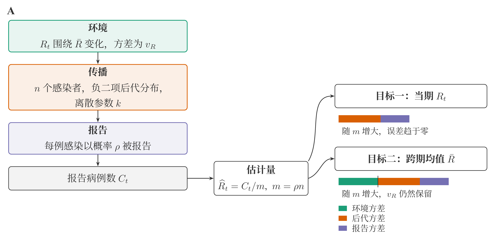
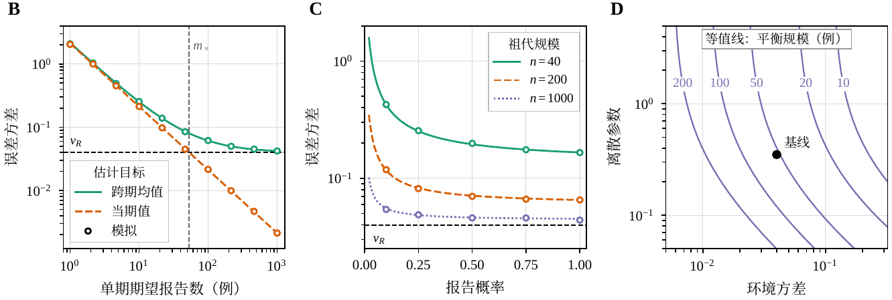
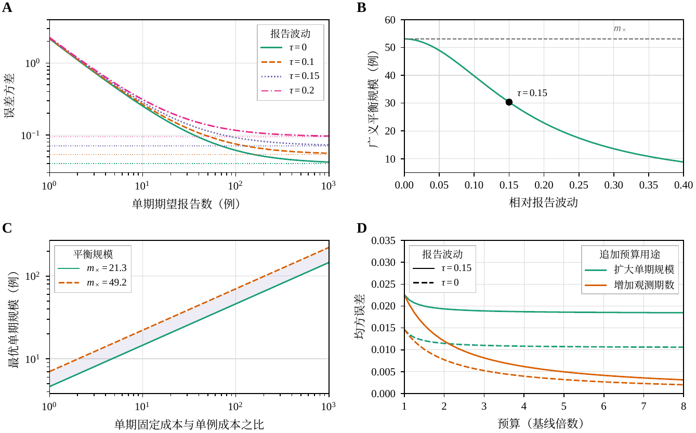
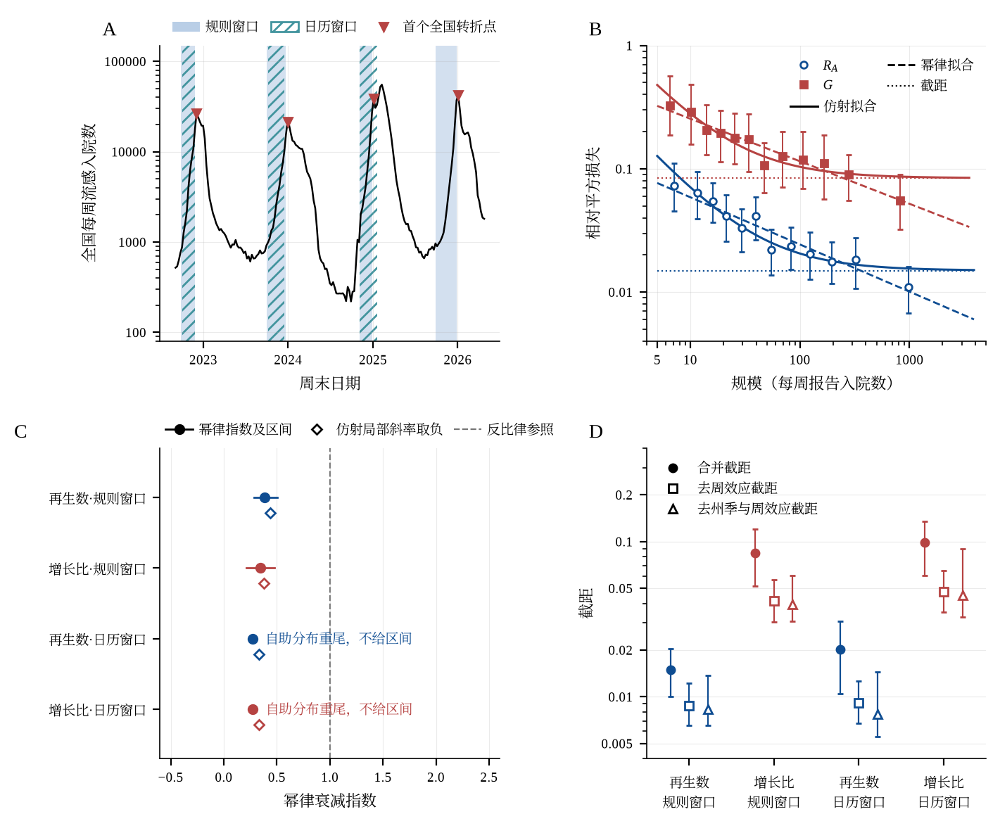
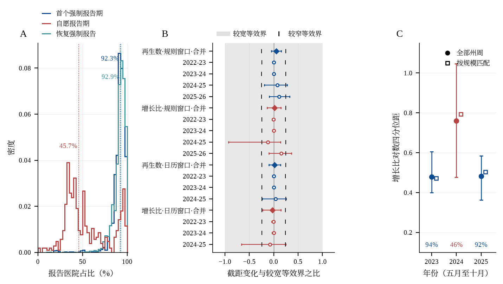
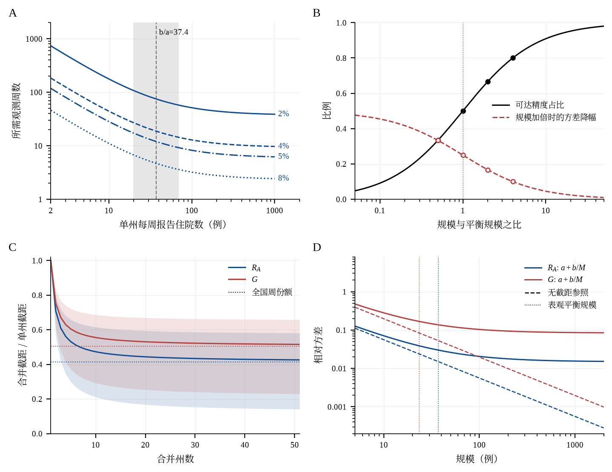
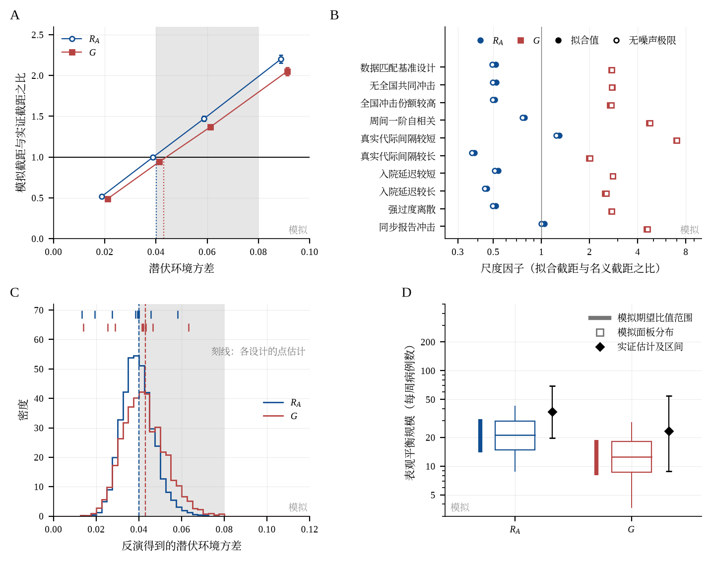
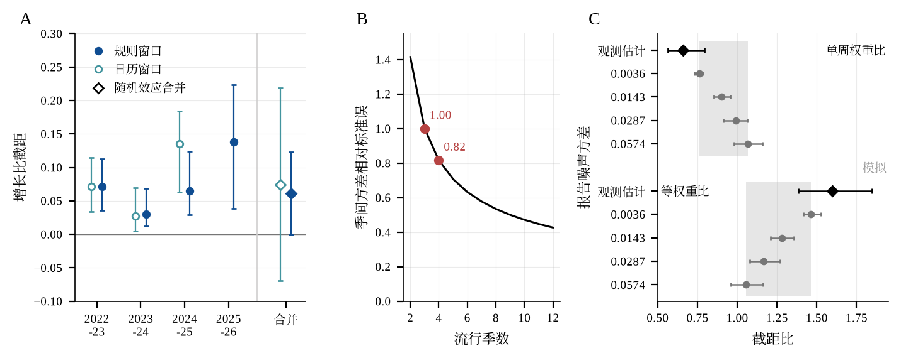

# 环境随机性与不完全报告下疫情再生数监测的精度极限与优化设计

## 摘要

由监测病例数得到的再生数估计通常被认为会随报告病例增多而更加精确。传播强度本身却随天气、学期和接触模式在时期之间变化，这部分变异为同一时期内的全部传播链所共有。本文把种群生态学中环境随机性与种群统计随机性的方差分解推广到后代服从负二项分布、感染按二项概率报告的再生数估计。固定报告概率、通过覆盖规模改变每期期望报告病例数 $m$ 时，跨期平均再生数估计的误差方差为 $v_R+A/m$，其中后代变异与报告变异随 $m$ 下降，环境方差 $v_R$ 不随之下降。在平衡规模 $m_{\times}=A/v_R$ 处，病例量加倍只使误差方差下降四分之一。报告完整度的波动另加一项不随病例量下降的方差并降低平衡规模；固定预算下，每期最优病例量为成本比与平衡规模的几何平均。利用美国国家医疗安全网络 2022–23 至 2025–26 四个流感季早期增长窗口中 51 个辖区的每周住院数据，以州 $\times$ 周双向自助法估计相对损失 $a+b/M$。更新型比值的截距为 0.0150（95% CI：0.0100, 0.0205），表观平衡规模 $b/a$ 为每周 37.4 例住院（95% CI：19.7, 69.7）；加权增长比给出截距 0.0840 与 $b/a=23.5$。两种统计量截距中约 41%–51% 为同一周内各州所共有。强制报告期内，按医院报告完整度调整后的截距变化落在由独立有界乘性报告冲击校准的等效界之内；自愿报告期增长统计量的四分位距约为前后两年的 1.6 倍，其 95% 区间包含 1。规则窗口中 55%–65% 的州周已位于表观平衡规模之上；在这一范围内，把追加资源用于延长观测期和合并变异不同步的辖区，比增加单期病例数更能提高平均再生数估计的精度。

**关键词：**再生数；环境随机性；不完全报告；监测设计；平衡规模；流感住院

## 1. 引言

时变再生数估计已成为传染病监测的常规产出。此类估计曾用于追踪西非埃博拉病毒病的传播(Nouvellet et al., 2018)、评估针对 COVID-19 的非药物干预(Flaxman et al., 2020)，以及描述 SARS-CoV-2 的早期传播(Kucharski et al., 2020)。目前许多国家已常规发布再生数估计(Huisman et al., 2022)，其估计方法也有实践指南可循(Gostic et al., 2020; Steyn et al., 2025)。再生数估计对态势感知的价值，取决于依据监测系统实际收集的数据能够把它估计到何种精度。

瞬时再生数 $R_t$ 定义为：若 $t$ 时刻的条件保持不变，在该时刻被感染的个体所产生的二代感染的期望数(Fraser, 2007)。$R_t$ 通常借助更新方程从发病数估计，更新方程按代际间隔（原发病例被感染到其二代病例被感染之间的时间）对既往发病数加权(Wallinga and Teunis, 2004; Cori et al., 2013; Thompson et al., 2019)。在代际间隔给定时，此类估计的后验不确定性随估计窗口内病例数的增加而缩小(Cori et al., 2013)。Parag 等人以闭式刻画了发病数所含关于 $R_t$ 的信息量，其中包括随时间变化的报告比例造成的信息损失，并推导了这一信息量对及时决策的限制(Parag, 2021; Parag et al., 2022, 2025)。已有扩展处理了时间聚合的计数(Nash et al., 2023; Ogi-Gittins et al., 2024)，以及感染的再生数与延迟观测序列的表观再生数之间的差异(Eales and Riley, 2024)。

上述精度结果采用同一基准，即误差相对于所估时期 $R_t$ 的实现值来度量，并随病例数增加而趋于零。$R_t$ 估计的许多用途则指向跨期持续存在的量，例如一个流行季的典型传播水平或下一周的期望值。政策评估同样要对天气、学校日历和接触模式各不相同的若干周取平均(Dalziel et al., 2018)。$R_t$ 在时期之间的变异为同一时间人群中的全部传播链所共有。种群生态学把这类环境随机性与源于个体独立结局的种群统计随机性区分开来(Engen et al., 1998; Rohani et al., 2002; Lande et al., 2003)，机制性流行病模型也已同时纳入这两种随机性(Bretó et al., 2009)。每个个体分摊的种群统计方差随种群规模增大而下降，环境方差则保持不变；两种贡献相等时的种群规模是灭绝风险的标准概括量(Lande et al., 2003)。过度离散的后代分布(Lloyd-Smith et al., 2005; Endo et al., 2020)与不完全报告都归入这一划分中的种群统计一侧。

监测数据还引入第三个变异来源。进入计数的感染比例随检测实践、就医行为和医疗机构报告完整度而随时间变化(Azmon et al., 2014; Stoner et al., 2019; Parag and Donnelly, 2022)。在美国，医院向美国国家医疗安全网络（NHSN）报告流感住院人数在 2024 年 4 月之前为强制要求，2024 年 5 月至 10 月改为自愿报告，自 2024 年 11 月起恢复强制(Centers for Disease Control and Prevention, 2026)。此类住院序列越来越多地用于预测和实时评估(Mathis et al., 2024)。在一周之内持续存在的报告完整度变异作用于该周的每一个病例，因此其作用方式与环境变异相同，有别于抽样噪声。

监测的样本量计算通常假定病例越多，精度按比例越高(Cochran, 1977)；关于再生数估计的分析则集中于发病数据对逐期取值的信息量(Parag et al., 2022; Bhatt et al., 2023)。据我们所知，生态学的方差分解尚未被引入再生数监测的设计；引入时需要纳入过度离散的后代分布、完整度波动的二项报告，以及分摊到多个时期的预算。实证检验还面临一个测量问题。由住院数计算的周增长统计量属于表观量，其方差取决于由感染到入院的延迟以及各统计量在一周之内汇总增长的方式，因此其截距不能直接解读为传播方差。同一日历周的观测共同受到全国性因素的影响，把它们视为相互独立的区间估计会过窄(Cameron et al., 2011)。

本文把生态学的方差分解推广到 $R_t$ 存在环境变异、后代服从负二项分布、报告服从二项分布时基于病例数的再生数估计，推导环境贡献与抽样贡献相等时的平衡规模。文中区分两条提高病例量的路径：报告概率固定而扩大覆盖规模，以及覆盖规模固定而提高报告概率。在此基础上，分析报告异质性对平衡规模的影响，以及固定预算如何在每期病例数与时期数之间分配。随后，利用 NHSN 的每周流感住院数据，以两种表观周统计量估计相对损失的截距与表观平衡规模，把截距分解为全国周分量与州特有分量，并比较强制报告与自愿报告两种制度。最后，借助数据匹配模拟把表观截距映射到潜在环境方差，作为对实证尺度的补充解释。

## 2. 材料与方法

### 2.1. 传播、报告与两类估计目标

考虑以 $t$ 为索引的一代传播，其中 $n$ 名感染者作为原发病例。假设给定瞬时再生数 $R_t$ 时，原发病例 $i$ 引起的继发感染数 $X_{i,t}$ 服从负二项分布，以刻画传播中的个体异质性(Lloyd-Smith et al., 2005)。后代分布为

$$
X_{i,t}\mid R_t \sim \mathrm{NB}\!\left(k,\ \frac{k}{k+R_t}\right),\qquad \mathbb{E}(X_{i,t}\mid R_t)=R_t,\qquad \operatorname{Var}(X_{i,t}\mid R_t)=R_t+\frac{R_t{}^2}{k}, \tag{1}
$$

其中 $k\gt 0$ 为离散参数，$k$ 越小，异质性越强；$k\to\infty$ 时退化为 Poisson 后代分布。每例感染随后以概率 $\rho\in(0,1]$ 独立报告。成功概率相同的独立负二项变量之和仍服从负二项分布，二项稀疏化也保持这一分布族，因此报告病例数 $C_t$ 满足

$$
C_t\mid n,R_t \sim \mathrm{NB}\!\left(nk,\ \frac{k}{k+\rho R_t}\right),\qquad \mathbb{E}(C_t\mid n,R_t)=\rho nR_t,\qquad \operatorname{Var}(C_t\mid n,R_t)=\rho nR_t+\frac{\rho^2nR_t{}^2}{k}, \tag{2}
$$

其中 $m=\rho n$ 为 $R_t=1$ 时每个时期的期望报告病例数，下文称 $m$ 为病例量。

模型建立在四项假设之上。每例感染以不随时间变化的概率 $\rho$ 独立报告（H1）。原发病例按式 (1) 独立同分布地传播（H2）。离散参数 $k$ 与 $R_t$ 和 $n$ 无关（H3）。原发病例数 $n$ 由设计固定，且与 $R_t$ 相互独立（H4）。当 $n$ 由接触者追踪确定时，假设 H4 成立；常规监测中 $n$ 本身是早期传播的结果，第 2.6 节的更新方程形式放宽了这一假设。

传播潜力随天气、学期、节假日和人群行为在时期之间变化(Dalziel et al., 2018)，其边际矩记为 $\mathbb{E}(R_t)=\bar{R}$ 与 $\operatorname{Var}(R_t)=v_R$。这类变异同时作用于同一时期内的每条传播链，对应种群生态学中的环境随机性；式 (2) 中的后代变异与报告变异则对应种群统计随机性(Engen et al., 1998; Lande et al., 2003)。

尺度化病例数 $\hat{R}_t=C_t/m$ 可服务于两个不同的估计目标。第一个目标是当期值 $R_t$，用于态势感知，也用于判断当前 $R_t$ 是否大于一。第二个目标是跨期均值 $\bar{R}$，用于描述一个流行季内的典型传播水平；当 $R_t$ 在各时期间相互独立时，$\bar{R}$ 也是下一时期取值的最优一步预测。第一个目标的误差为 $\hat{R}_t-R_t$，第二个目标的误差可写为

$$
\hat{R}_t-\bar{R}=(\hat{R}_t-R_t)+(R_t-\bar{R}), \tag{3}
$$

其中第二项与 $m$ 无关。给定 $R_t$ 时，$\hat{R}_t$ 是 $R_t$ 的无偏估计，其方差 $R_t/m+\rho R_t{}^2/(km)$ 随 $m$ 增大趋于零，并达到 $R_t$ 的 Cramér–Rao 下界（附录 A.2）。

### 2.2. 误差方差与平衡规模

对第二个目标，将全方差公式应用于式 (3) 即可得到误差方差。

**命题 1**（跨期均值的误差方差）．在 H1–H4 下，$\hat{R}_t=C_t/(\rho n)$ 围绕 $\bar{R}$ 的方差为

$$
V(n,\rho)=v_R+\frac{\bar{R}}{\rho n}+\frac{\bar{R}^2+v_R}{kn}=v_R+\frac{A}{m}, \qquad A=\bar{R}+\frac{\rho(\bar{R}^2+v_R)}{k}, \tag{4}
$$

其中三项依次为环境贡献、报告贡献与后代贡献。由式 (4) 可得以下四点。

1. （i）对固定的 $\rho$，当 $n\to\infty$ 时 $V\to v_R$。
2. （ii）对固定的 $n$，当 $\rho\to1$ 时 $V\to v_R+\bar{R}/n+(\bar{R}^2+v_R)/(kn)\gt v_R$。
3. （iii）固定 $\rho$、$k$ 与 $R_t$ 的分布，经由 $n$ 改变 $m=\rho n$ 时，在平衡规模 $m_{\times}=A/v_R$ 处抽样贡献与环境贡献相等；$m$ 加倍使 $V$ 按比例 $1/[2(1+m/m_{\times})]$ 减小，在 $m=m_{\times}$ 处为四分之一。
4. （iv）在对 $R_t$ 条件无偏的估计量中，任何估计量对 $\bar{R}$ 的均方误差均不小于 $V$。

第（iii）项中的 $A$ 依赖于 $\rho$，因此平衡规模和加倍收益只对固定 $\rho$ 的路径成立。若固定 $n$ 而把 $\rho$ 提高到 $2\rho$（要求 $\rho\le1/2$），只有报告项减半，方差的相对降幅为 $\bar{R}/[2\rho nV(n,\rho)]$，后代项 $(\bar{R}^2+v_R)/(kn)$ 不变；这一路径的可达下限为第（ii）项给出的取值。两条路径的对数边际分别为 $-\partial V/\partial\log n=\bar{R}/(\rho n)+(\bar{R}^2+v_R)/(kn)=A/m$ 和 $-\partial V/\partial\log\rho=\bar{R}/(\rho n)=\bar{R}/m$，二者之比为 $A/\bar{R}$（附录 A.3）。

平衡规模的作用相当于生态学模型中的临界种群规模；在临界种群规模处，种群增长方差的种群统计贡献与环境贡献相等(Lande et al., 2003)。平衡规模是比较两类贡献的参照点，本身不界定最低运行规模。第（iv）项仅适用于条件无偏估计量。将 $\hat{R}_t$ 向先验均值收缩的估计量对 $\bar{R}$ 的误差可能更小（附录 C.5）；对 $T$ 个独立时期取平均，可将环境项降至 $v_R/T$（命题 3）。极限 $v_R$ 还假设环境变异在时期之间和地点之间相互独立。若 $R_t$ 服从自相关系数为 $\phi$ 的平稳一阶自回归过程，一步预测误差中的环境部分降至 $(1-\phi^2)v_R$。若 $J$ 个辖区的环境方差均为 $v_R$，两两相关系数的均值为 $\bar{c}$，则这些辖区平均值的环境方差为

$$
v_R\,\bar{c}+\frac{v_R(1-\bar{c})}{J}, \tag{5}
$$

即汇总仅在变异不同步（$\bar{c}\lt 1$）的范围内降低这一极限。

### 2.3. 报告异质性与监测预算分配

报告完整度很少保持恒定。假设 H1 可替换为如下假设：报告概率 $p_t$ 在时期之间变化，且与 $R_t$、$n$ 相互独立，其均值为 $\rho$，相对波动为 $\tau=\mathrm{SD}(p_t)/\rho$；给定 $R_t$ 与 $p_t$ 时，各时期病例数相互独立（H5）。

**命题 2**（报告异质性）．在 H2–H5 下，$\hat{R}_t=C_t/m$ 围绕 $\bar{R}$ 的误差方差可写为

$$
V_H(m)=v_R+v_H+\frac{A_H}{m},\qquad v_H=\tau^2(\bar{R}^2+v_R),\qquad A_H=\bar{R}+\frac{\rho(1+\tau^2)(\bar{R}^2+v_R)}{k}, \tag{6}
$$

其中 $v_H$ 为报告异质性引入的附加方差。极限方差升至 $v_R+v_H$，平衡规模降至 $m_{\times,H}=A_H/(v_R+v_H)\lt m_{\times}$。仅凭病例数的均值与方差无法区分 $v_R$ 与 $v_H$，这两个矩只能识别 $(1+\tau^2)(\bar{R}^2+v_R)$。

命题 2 构成实证部分的识别边界：若不单独测量报告过程，仅由病例数估计的截距同时包含传播变异与报告变异。实际增长统计量的分子与分母来自同一报告序列，报告冲击还会在相邻周之间产生负的协方差，并通过分母进入均值；附录 B.1 给出随机分子分母下的二阶展开及其对增长比与更新型比值的含义。

平衡规模还决定固定预算的最优分配方式。设共观测 $T$ 个时期，每个时期的病例量为 $m$，每个时期的成本为 $c_0$，每例报告病例的成本为 $c_1$，总预算为 $\mathcal{B}=T(c_0+c_1m)$。

**命题 3**（固定预算的分配）．在 H1–H4 下固定 $\rho$，经由 $n$ 改变 $m$。若 $R_t$ 在各时期间相互独立，则 $T$ 个时期内 $\hat{R}_t$ 均值的方差为

$$
\frac{v_R}{T}+\frac{A}{Tm}, \tag{7}
$$

当 $c_0,c_1,v_R,A\gt 0$ 且连续内点可行时，预算约束下上述方差的唯一最小值点为

$$
m^*=\sqrt{\frac{c_0}{c_1}\,m_{\times}}, \tag{8}
$$

其中 $T^*=\mathcal{B}/(c_0+c_1m^*)$，并要求 $T^*\ge1$。若 $R_t$ 服从自相关系数为 $\phi$ 的平稳一阶自回归过程，抽样项保持不变，环境项变为 $v_RS(\phi,T)/T^2$，其中 $S(\phi,T)$ 为

$$
S(\phi,T)=\frac{T(1+\phi)}{1-\phi}-\frac{2\phi(1-\phi^T)}{(1-\phi)^2}. \tag{9}
$$

每个时期的最优病例量为 $c_0/c_1$ 与平衡规模的几何平均，与两阶段抽样中二级单元最优数量的形式相同(Cochran, 1977)。$m$ 超过 $m^*$ 后，追加预算用于增加时期数比用于增加病例数更能降低误差。整数时期数、最低时期数和规模上限需另行约束，并与边界解比较。环境存在自相关时，一阶条件变为 $m^2=c_0A/(c_1v_Rg_T)$，其中 $g_T$ 由式 (9) 对 $T$ 求导得到；这一条件是必要条件，相应的预算阈值见附录 C.2。

固定 $n$ 而改变 $\rho$ 的预算问题与上式不同。令 $H=v_R+(\bar{R}^2+v_R)/(kn)$、$Q=\bar{R}/n$，单期成本为 $c_0+c_\rho\rho$，则单期方差为 $H+Q/\rho$，内点最优报告概率为 $\rho^*=\sqrt{c_0Q/(c_\rho H)}$，再截取到 $(0,1]$。即使成本仍以每例报告病例 $c_1$ 计价，此路径也有 $c_\rho=c_1n$，不能套用式 (8)（附录 A.5）。

报告异质性可能逆转覆盖规模与报告完整度作为投入方向的优先次序。

**推论 1**（覆盖规模与报告完整度的比较）．若 $\tau$ 不依赖于 $\rho$，扩大覆盖规模 $n$ 对 $V_H$ 的降幅大于 $\rho$ 同比例提高时的降幅。若报告变异来自对 $\nu$ 个单位的二项抽样，即 $\operatorname{Var}(p_t)=\rho(1-\rho)/(\nu+1)$，则在下式成立时提高 $\rho$ 更为有利

$$
m\gt \frac{\rho^2\nu}{k}, \tag{10}
$$

其中 $\nu$ 为每个时期抽样的报告单位数。

理论量的基线取值为 $\bar{R}=1.15$、$v_R=0.04$、$k=0.35$、$\rho=0.25$ 与 $\tau=0.15$，闭式量及其适用条件列于表 S7。

### 2.4. 数据与分析窗口

每周实验室确诊流感住院人数及报告医院百分比取自美国国家医疗安全网络（NHSN）的 Weekly Hospital Respiratory Data 数据表，覆盖美国 50 个州和哥伦比亚特区(Centers for Disease Control and Prevention, 2026)，所用版本于 2026-10-20 获取。数据表共含 2020-08-08 至 2026-10-10 的 21641 个辖区周。2024 年 4 月 30 日前为强制报告期，2024 年 5 月 1 日至 10 月 31 日为自愿报告期，2024 年 11 月 1 日起恢复强制报告(Centers for Medicare and Medicaid Services, 2024)；在三个报告期内，报告规模不低于五的辖区周分别为 6009、420 和 4077 个。

分析采用两组并列的早期增长窗口。规则窗口覆盖 2022–23 至 2025–26 四个流行季。每个窗口自 10 月 1 日起（2024 年自强制报告恢复后的 11 月 9 日起），包含全国周增长比不低于 1.05 的连续周，并于全国首个转折点的前一周结束，依次为 2022-10-01 至 2022-11-26、2023-10-07 至 2023-12-23、2024-11-09 至 2024-12-28 以及 2025-10-04 至 2025-12-27，共 42 个日历周。日历窗口覆盖 2022–23 至 2024–25 三个流行季的固定日期区间，依次为 2022-10-08 至 2022-11-26、2023-10-14 至 2023-12-16 以及 2024-11-09 至 2025-01-18，共 29 个日历周。两组窗口在 2022–23 与 2023–24 季大部分重叠，在 2024–25 季的终点不同，并分别报告。所有窗口均未纳入以零填补的病例数。观察性部分按 STROBE 声明的要素报告。

### 2.5. 周增长统计量

对每个州和每一周计算两个周增长统计量。加权增长比定义为

$$
G_t=\frac{C_{t+1}}{D_t},\qquad D_t=0.65\,C_t+0.25\,C_{t-1}+0.10\,C_{t-2}, \tag{11}
$$

其中 $C_t$ 为第 $t$ 周的住院人数，$D_t$ 为加权报告规模，权重满足 $\sum_jw_j{}^2=0.495$。$G$ 仅使用 $D_t\ge5$ 的周。更新型比值借助代际间隔将单周增长换算为再生数(Wallinga and Lipsitch, 2007)，其定义为

$$
R_{A,t}=\left(1+r_t\theta\right)^{\alpha},\qquad r_t=\frac{1}{7}\log\frac{C_{t+1}+0.5}{C_t+0.5}, \tag{12}
$$

其中 $r_t$ 为日增长率；代际间隔取均值 3.6 天、标准差 1.6 天的伽马分布（取 Cowling et al. (2009) 估计的家庭序列间隔），形状参数 $\alpha=(3.6/1.6)^2=5.0625$，尺度参数 $\theta=1.6^2/3.6=0.711111$ 天。$R_A$ 只在 $D_t\ge5$ 且 $C_t\ge5$ 的周计算。$R_A$ 由观测增长变换得到，并非 $R_t$ 的后验估计(Cori et al., 2013)；两种统计量都属于表观量。

下文以 $M$ 泛指相对损失模型中的规模变量：$R_A$ 只含 $C_{t+1}$ 与 $C_t$，取 $M=C_t$；$G$ 的分母为三周加权和，取 $M=D_t$。两者都是住院代理，不等同于理论中的报告后有效感染压力 $m$。

### 2.6. 期望损失与表观平衡规模

常规监测中原发病例数无法观测，继发感染来源于感染压力 $\Lambda_{t+1}=\sum_{j\ge1}w_jI_{t+1-j}$(Fraser, 2007; Cori et al., 2013)。给定历史 $\mathcal{F}_t$，对 $C_{t+1}$ 应用全方差公式，并令 $m=\rho\mathbb{E}(\Lambda_{t+1}\mid\mathcal{F}_t)$，相对预测方差可写为

$$
\frac{\operatorname{Var}(C_{t+1}\mid\mathcal{F}_t)}{m^2}=v_R+\frac{A}{m}+\mathrm{CV}^2(\Lambda_{t+1}\mid\mathcal{F}_t)\,(\bar{R}^2+v_R), \tag{13}
$$

其中 $\mathrm{CV}$ 为变异系数。最后一项是另一个与规模无关的分量，仅在感染压力已知时消失。对于中心为 $\bar{X}$ 的统计量 $X_t$，相对损失 $L_t=[(X_t-\bar{X})/\bar{X}]^2$ 的模型设定为

$$
\mathbb{E}(L_t\mid M_t)=a+\frac{b}{M_t}, \tag{14}
$$

称 $b/a$ 为表观平衡规模，以区别于理论平衡规模 $m_{\times}=A/v_R$。在一代恰为一周、无额外延迟、报告率固定已知且分母不含噪声的理想情形下，$a=v_R/\bar{R}^2$、$b=A/\bar{R}^2$，$b/a=m_{\times}$。实际数据中 $D_t$ 经由感染到入院的延迟、周聚合和报告形成，分母本身带有报告误差，$R_A$ 还对增长作非线性变换，因此 $b/a$ 与 $m_{\times}$ 之间需要显式校准，二者并不恒等（附录 B.2）。若分母中只含二项噪声，其相对方差为 $(1-\rho)\sum_jw_j{}^2/m$，这一噪声使斜率近似增大为

$$
b\approx\frac{A+(1-\rho)(\bar{R}^2+v_R)\sum_jw_j{}^2}{\bar{R}^2}. \tag{15}
$$

计算潜在平衡规模的情景范围时，$\bar{R}$ 取 $G$ 的样本均值，$v_R\in\{0.04,0.08\}$，$k\in\{0.2,0.5\}$(Lloyd-Smith et al., 2005)，每例感染的住院概率 $\rho\in\{0.0056,0.021\}$(Tokars et al., 2018)；这些情景下的平衡规模为 21.3–49.2 例。

中心 $\bar{X}$ 的定义构成以下层级。每一层在各自的样本上估计，并在每次自助重复中重新估计。

1. （1）主分析：各设定合并全部窗口的样本均值。
2. （2）去除全国周效应：同一日历周内各州的均值，偏差乘以小样本因子 $n_w/(n_w-1)$，$n_w$ 为该周的州数。
3. （3）州–季加性：以交替投影估计的周效应与州–季效应之和。
4. （4）分季：各流行季窗口内的均值，用于分季截距。
5. （5）报告完整度：未调整与覆盖校正的统计量在同一覆盖有效子样本上各按自身均值中心化，并使用同一规模 $M$。

### 2.7. 估计与推断

式 (14) 采用可行广义最小二乘拟合，权重为 $1/\hat{\mu}^2$，其中 $\hat{\mu}$ 为上一次迭代的拟合均值，迭代直至收敛(Wooldridge, 2010)。同一州的观测在时间上相关，同一周的观测共享全国性影响，因此不确定性采用州 $\times$ 周双向自助法估计(Cameron et al., 2008, 2011)。每次重复对 51 个州有放回抽样一次，对各流行季窗口内的周分别有放回抽样，以州抽取次数与周抽取次数之积作为观测权重。同一组抽取次数在 $R_A$ 与 $G$ 之间共享，中心在每次重复中重新估计。每个设定使用 2000 次重复，种子为 20261029，区间为百分位区间。为说明聚类结构的影响，另报告仅对州重抽样所得截距标准差与双向标准差之比。

截距分解依次以第 2.6 节层级中的（2）与（3）重新拟合式 (14)。全国周份额定义为 $(a-a_{\text{周}})/a$，州–季分量为加入州–季效应后截距的进一步变化。作为对函数形式的描述，同时拟合无截距幂律 $\mathbb{E}(L_t\mid M_t)=cM_t{}^{-\gamma}$。仿射模型的局部对数斜率为 $-1/[1+M/(b/a)]$，其在观测规模上的平均值是几何描述；$\gamma$ 由另一全局拟合目标决定，与平均局部斜率之间不存在恒等关系。幂律拟合在部分自助重复中不收敛到内点，自助分布因此出现重尾，以标准差为基础的区间与百分位区间不一致。规则窗口报告 $\gamma$ 的百分位区间及不收敛重复的比例；日历窗口不收敛比例超过 13%，只报告点估计。本文不对 $\gamma=1$ 作检验，截距是否为正与两种拟合在分箱均值上的接近程度一并作为描述性证据。

### 2.8. 报告完整度

将各州各周的住院人数除以对应的报告医院比例，得到覆盖校正统计量。检验对象为 $\Delta a=a_{\mathrm{raw}}-a_{\mathrm{adj}}$，即同一覆盖有效子样本、同一规模 $M$ 上两个按自身均值中心化的 FGLS 截距之差。等效性采用 5% 水平的双单侧检验（TOST）：$\Delta a$ 的 90% 配对双向自助区间完全落在 $(-\delta,\delta)$ 之内时判为等效(Schuirmann, 1987)。

等效界 $\delta$ 须与截距统计量处于同一尺度，因此由配对校准得到，而不直接取命题 2 中的 $v_H$。每次校准重复中，对每个州周抽取 $U_{it}\sim\mathrm{Uniform}(-\sqrt3,\sqrt3)$，把观测住院数乘以 $(1+\tau_0U_{it})$。同一冲击同时进入它所在周作为分子和作为分母的各项，规模 $M$ 保持不变。随后按与实证分析相同的变换、中心化与 FGLS 重新拟合截距。$\delta$ 取 2000 次重复中截距增量的平均值，$\tau_0=0.10$ 与 0.05 两个水平分别计算，并报告其蒙特卡罗标准误。这一界因此对应独立有界乘性报告冲击模型下的敏感性问题。它检验观测到的截距变化是否小于相对波动为 $\tau_0$ 的独立报告冲击所能产生的截距变化。合并样本的检验为主要结果，分季检验作为描述。医院报告比例是机构参与度的代理，不包括报告医院内部检测强度与编码的变化。

自愿报告期只有 2024 年 5 月至 10 月一个非流行季，样本中低规模州周占多数，FGLS 截距在这一时段不稳定（自愿报告期的点估计为负）。对这一对照改用稳健的离散度量：比较 2023 年、2024 年与 2025 年 5 月至 10 月间 $\log[(C_{t+1}+0.5)/(D_t+0.5)]$ 的四分位距。区间来自 2000 次双向自助重复（州抽取次数在三年间共享，周在年内抽样，种子 20261941）。为排除规模构成差异，另按 2023 年与 2025 年合并样本中 $\log D_t$ 的十分位分布对各年重新加权，并按日历月逐月比较。

### 2.9. 流行季与分母权重

各流行季截距采用 DerSimonian–Laird 随机效应模型合并(DerSimonian and Laird, 1986)；合并截距采用自由度为 $S-1$ 的 $t$ 区间，季间方差采用 Q-profile 区间。推论 2 给出任一季间方差估计相对标准误的下界(Searle et al., 1992)。截距比 $q_1=a_{(1,0,0)}/a_{w}$ 与 $q_2=a_{(1/3,1/3,1/3)}/a_{w}$ 分别将单周分母与等权三周分母同式 (11) 的权重相比较，在规则窗口中计算，区间来自与 $G$ 相同的双向自助抽取。比较基准为纯报告噪声零模型：以平滑后的全国流行季曲线和各州固定份额给出期望住院数，乘以对数正态报告率（$\mathrm{CV}^2\in\{0.0036,0.0143,0.0287,0.0574\}$）后作泊松抽样，不含环境变异。在每条模拟的全国路径上按同一规则重新选择窗口，每个噪声水平重复 300 次。零模型范围取各噪声水平下比值均值的极差，观测比值落在范围之外的双侧 $p$ 值由自助分布计算。

### 2.10. 通用独立面板模拟

理论结果与表观统计量的性质通过两类蒙特卡罗模拟检验。图 1 中的每个点基于 20000 次重复。通用独立面板设计中，表观周统计量由日尺度更新模型模拟生成，取 $\bar{R}=1.2$，代际间隔同上。每周 $R_t$ 在各周间独立地从方差为 $v_R$ 的伽马分布中抽取；后代服从负二项分布；住院经均值 5.5 天、标准差 3.0 天的伽马延迟后以概率 $\rho_h$ 二项发生，延迟分布的参数为假定值。每个重复包含 500 个州，初始报告规模在 2 与 150 之间服从对数均匀分布，另含四个预热周与六个观测周。十七个情景由 $v_R\in\{0.01,0.02,0.04,0.08,0.16\}$ 与 $k\in\{0.1,0.35,1\}$ 在 $\rho_h=0.01$ 下交叉组合，并在基线设定下增加 $\rho_h\in\{0.005,0.02\}$，每个情景重复 20 次。每个截距的无噪声极限来自 20000 个州的平均场运行，其中全部计数噪声均以期望值代替。

### 2.11. 潜在环境方差的模拟反演

作为补充分析，实证截距经两步映射为潜在环境方差 $v_R$。第一步，以数据匹配的模拟器给出各统计量期望拟合截距随 $v_R$ 变化的函数。每个模拟面板的横截面与长度和分析面板相同，包含 51 个州和四个规则窗口，观测周数依次为 9、12、8 和 13。流行季均值 $R_s$ 取各窗口全国周增长几何均值的更新型变换，各州初始住院数等于该州在窗口首周的观测住院数。周再生数为 $R_{i,s,w}=R_s+\eta_{s,w}+\varepsilon_{i,s,w}$，其中全国周冲击 $\eta$ 的方差为 $0.45\,v_R$，为所有州共有；州冲击 $\varepsilon$ 的方差为 $0.55\,v_R$；取值在 0.05 处截断。0.45 取在两种统计量观测到的全国周份额之间，因此模拟对组内相关系数与全国周份额的复现只是一致性检查。传播为后代服从负二项分布（$k=0.35$）的日尺度更新过程，住院经上述延迟后以概率 $\rho_h=0.01$ 二项发生；两种统计量的计算与筛选完全按数据处理，分析者采用均值 3.6 天的代际间隔。设计取 $v_R\in\{0.02,0.04,0.06,0.09\}$，每个取值 200 个面板，对每个面板拟合式 (14)。校准线 $\mathbb{E}(\hat{a})=\gamma_0+\gamma_1v_R$ 采用加权最小二乘拟合，权重为各均值蒙特卡罗方差的倒数；尺度因子 $\kappa=\mathbb{E}(\hat{a})/(v_R/\bar{R}^2)$ 中的 $\bar{R}$ 取按观测行加权的真实均值。

第二步，对各统计量计算隐含方差 $v_R^{\mathrm{impl}}=(a-\gamma_0)/\gamma_1$。其区间合并两部分变异：两个实证截距的 2000 次联合双向自助抽样（两者共用州与周的抽取次数，种子 20261921），以及 $(\gamma_0,\gamma_1)$ 按其蒙特卡罗抽样分布的独立抽取（种子 20261922）。两种统计量的一致定义为两者之差的 95% 区间包含零，即未拒绝。敏感性设定每次只改变设计中的一个要素（表 S8）。全国冲击被去除或份额提高到 0.65，周间一阶自相关取 0.5 或 0.25，真实代际间隔均值取 2.2、2.9 或 4.3 天而分析者仍用 3.6 天。其余设定把延迟均值改为 3.5 天或 8 天，把 $k$ 降至 0.1，以作用于报告计数的同步乘性冲击代替传播冲击，或令每周住院数取自方差均值比为 1.5 或 2.0 的伽马–泊松混合（表 S9）。周冲击的独立性以各统计量 $x/\bar{x}-1$ 在州–季节块内的汇总滞后一阶自相关检验，区间来自 1000 次按州整群的自助抽样，并与 $v_R=0.04$ 时模拟面板中的分布比较。校准后的理论 $b/a$ 采用同一设计，取 $v_R\in\{0.04,0.08\}$、$k\in\{0.2,0.5\}$ 与 $\rho_h\in\{0.0056,0.021\}$；单个面板间 $b/a$ 的取值范围给出同等规模单个面板的预期分布。模拟种子由 20261020 按设定、$v_R$ 取值与重复块索引派生。

## 3. 结果

### 3.1. 增加病例量对平均再生数估计的收益递减

**图 1**　环境变异、后代变异与报告变异对再生数尺度化估计量误差的贡献。（A）以报告病例数除以期望病例量的估计量及其两个估计目标（当期值与跨期均值）的示意图，颜色区分环境、后代与报告三类误差来源。（B）固定报告概率时，跨期均值与当期值的误差方差随单期期望报告病例数的变化；曲线为闭式解，圆点为蒙特卡罗估计及其 95% 区间，虚线标出环境方差 $v_R$ 与平衡规模。（C）三种固定原发病例数下误差方差随报告概率的变化；完全报告时的取值为残余后代项。（D）平衡规模在环境方差与后代离散参数平面上的等值线，图中标出基线参数组合。

在基线参数下（$\bar{R}=1.15$，$v_R=0.04$，$k=0.35$，$\rho=0.25$），抽样系数 $A=2.1232$，平衡规模为每期 $m_{\times}=53.1$ 例报告病例（图 1B）。当期值的误差方差在整个范围内与 $1/m$ 成比例下降，跨期均值的误差方差则逐渐趋于 $v_R$。固定 $\rho$ 而经由覆盖规模使病例量加倍时，跨期均值的误差方差在 $m=10$ 处下降 42.1%，在 $m=m_{\times}$ 处下降 25.0%，在 $m=200$ 处下降 10.5%。每个点基于 20000 次重复的蒙特卡罗估计与式 (4) 的偏差至多为 4.0%。

固定覆盖规模而提高报告概率，误差方差始终高于 $v_R$ 的水平（图 1C）。完全报告时，原发病例数为 40、200 和 1000 的残余方差分别为 0.166、0.0652 和 0.0450。以基线下位于平衡规模的覆盖规模 $n=212.3$ 为例，报告概率由 0.25 提高到 0.50 只使误差方差下降 13.5%，而经由 $n$ 使病例量加倍可下降 25.0%；即使完全报告，误差方差仍为 0.0638。在基线附近，覆盖规模按某一比例增加时误差方差的降幅，是报告概率按相同比例增加时降幅的 $A/\bar{R}=1.85$ 倍。环境方差较小且后代分布高度过离散时，平衡规模最大（图 1D）。

**图 2**　报告异质性与固定监测预算的分配。（A）四种相对报告波动水平下误差方差随单期期望报告病例数的变化；点线为病例量增大时相应的极限值，由环境方差与报告方差之和决定。（B）广义平衡规模随相对报告波动的变化；虚线为无报告波动时的平衡规模，圆点为面板（D）所用的波动水平。（C）取平衡规模情景范围的两端时，单期最优报告病例数随价格比 $c_0/c_1$ 的变化；阴影带覆盖两端之间的范围。（D）环境变异与报告变异均存在自相关时，平均再生数估计量的均方误差随总预算的变化，追加预算分别用于增加单期病例数或增加时期数；实线为基线报告，虚线为标准化报告。

相对报告波动 $\tau=0.15$ 使极限方差增加 $v_H=0.0307$，并使平衡规模由 53.1 例降至 30.4 例（图 2A、B）。按流感住院设定的情景参数，潜在平衡规模为 21.3–49.2 例。在此范围内，式 (8) 给出的最优病例量 $m^*$ 在 $c_0/c_1=10$ 时为每期 14.6–22.2 例，在 $c_0/c_1=100$ 时为每期 46.2–70.1 例（图 2C）；在基线 $m_{\times}=53.1$ 下分别为 23.0 例与 72.9 例。若固定 $n=212.3$ 而以报告概率为决策变量，$c_0=100$、$c_\rho=c_1n$ 时的最优报告概率为 $\rho^*=0.209$。在一个假设示例中，设共有十期、每期 50 例，环境与报告均存在自相关（$\phi=\psi=0.5$），且 $\tau=0.15$，此时跨期均值的均方误差为 $22.57\times10^{-3}$，其中环境部分为 $10.40\times10^{-3}$，报告部分为 $7.88\times10^{-3}$，抽样部分为 $4.29\times10^{-3}$（表 S7）。病例量增至十倍时，均方误差降至 $18.71\times10^{-3}$；报告标准化使其降至 $14.65\times10^{-3}$，时期数增至四倍则使其降至 $6.17\times10^{-3}$。预算为基线的两倍时，将增量用于病例所得均方误差为 $19.35\times10^{-3}$，用于时期所得均方误差为 $11.98\times10^{-3}$（图 2D）。

### 3.2. 流感住院数据中的截距与表观平衡规模

**图 3**　流感住院数据中两种周增长统计量的相对损失。（A）对数尺度下的全国每周流感住院人数；浅蓝阴影为规则窗口（$S=4$），斜线为日历窗口（$S=3$），三角形标出各流行季的首个全国转折点。（B）规则窗口中两种统计量按规模变量 $M$ 固定分为 12 个分箱的平均相对损失，误差线为州 $\times$ 周双向自助 95% 百分位区间；实线为仿射拟合 $a+b/M$，虚线为无截距幂律拟合 $cM^{-\gamma}$，点线为截距 $a$。（C）幂律指数 $\gamma$ 的点估计，规则窗口附双向自助 95% 百分位区间，日历窗口仅给点估计；空心菱形为仿射拟合在样本规模处局部对数斜率均值的相反数；虚线为 $\gamma=1$ 参照。（D）四种设定下的截距、去除全国周效应后的截距以及同时去除周效应与州–季效应后的截距，误差线为双向自助 95% 百分位区间。

在四个流行季的规则窗口中，42 个日历周内的 1748 个州周给出更新型比值的截距 $a=0.0150$（95% CI：0.0100, 0.0205）、斜率 $b=0.560$（95% CI：0.375, 0.761）以及表观平衡规模 $b/a=37.4$（95% CI：19.7, 69.7；图 3B，表 S1）。同一窗口中，加权增长比由 1756 个州周给出 $a=0.0840$（95% CI：0.0515, 0.1199）和 $b/a=23.5$（95% CI：8.8, 54.7）。两种统计量的样本差异来自规模条件，有 8 个州周的 $D_t\ge5$ 而当周住院数少于 5。三个日历窗口中，$R_A$ 给出 $a=0.0202$（95% CI：0.0104, 0.0307）与 $b/a=25.6$（95% CI：10.1, 73.9），$G$ 给出 $a=0.0991$（95% CI：0.0608, 0.1356）与 $b/a=22.6$（95% CI：9.4, 48.9）。四种设定的截距区间都位于零以上。截距的双向自助标准差是仅对州重抽样所得标准差的 1.96–3.49 倍；仅对州重抽样时，规则窗口 $R_A$ 截距的区间为 0.0124–0.0178，明显窄于双向区间。

在观测到的规模范围内，无截距幂律对分箱损失的拟合与仿射形式接近（图 3B）。规则窗口中幂律指数 $\gamma$ 对 $R_A$ 为 0.38（95% CI：0.29, 0.51），对 $G$ 为 0.35（95% CI：0.21, 0.48）；仿射拟合在样本规模处的平均局部对数斜率分别为 $-0.44$ 与 $-0.38$（图 3C，表 S2）。两组数值都远离反比律对应的 $-1$，说明在这一规模范围内损失随规模下降得比纯计数噪声慢。日历窗口的幂律指数点估计均为 0.27。$\gamma$ 与平均局部斜率出自不同的拟合目标，二者的接近只是几何上的对应。仿射形式的参数与命题 1 一一对应，因此后续分析以仿射形式为准。

### 3.3. 截距的多尺度分解

截距包含同一日历周内各州共有的分量和各州特有的分量（图 3D；表 S2）。去除全国周效应后，规则窗口中 $R_A$ 的截距由 0.0150 降至 0.0088（95% CI：0.0066, 0.0122），全国周份额为 41%（95% CI：12, 57）；$G$ 的截距由 0.0840 降至 0.0415（95% CI：0.0304, 0.0569），份额为 51%（95% CI：21, 65）。日历窗口中这一份额对 $R_A$ 为 55%，对 $G$ 为 52%。再去除州–季效应后截距变化很小，规则窗口中 $R_A$ 降至 0.0083（95% CI：0.0066, 0.0137），$G$ 降至 0.0394（95% CI：0.0305, 0.0602），四种设定中州–季分量的区间均包含零。同一周内的共有分量在统计上是全国周效应，不对应某个可单独识别的传播或报告机制。

全国周分量在同一周内进入每个州的损失。某州住院数增加只能缩小该州的计数项，对多州取平均只能缩小州特有项，两者都消除不了共有分量，只有增加观测周数才能把它平均掉。按式 (5) 的形式，若各州残差独立且规模相近，$J$ 个州合并后的截距约为单州的 $w+(1-w)/J$，其中 $w$ 为全国周份额；$R_A$ 在 $J=5$、10 和 51 时约为单州的 0.53、0.47 和 0.42，$G$ 约为 0.61、0.56 和 0.51（图 5C）。

### 3.4. 报告完整度

**图 4**　报告完整度与截距。（A）报告规模不低于 5 的州周中报告医院占比在三个报告期的分布，点线为中位数。（B）规则窗口与日历窗口中覆盖调整前后截距之差 $\Delta a$，以 $\tau_0=0.10$ 的等效界为单位。菱形为合并估计，圆圈为分季估计，误差线为配对双向自助 90% 百分位区间。灰带与竖刻线分别为 $\tau_0=0.10$ 与 $\tau_0=0.05$ 的等效界。（C）各年 5 月至 10 月 $\log G$ 的四分位距及州 $\times$ 周双向自助 95% 百分位区间，空心方块为按报告规模匹配后的值，底部数字为报告医院占比中位数。

在报告规模不低于 5 的州周中，报告医院占比的中位数在第一个强制报告期为 92.3%，在自愿报告期为 45.7%，恢复强制报告后为 92.9%（图 4A）。规则窗口内的中位数为 93.7%，79.8% 的州周至少有 90% 的医院报告。在这些窗口中，按报告占比调整统计量后，$R_A$ 的截距变化 $\Delta a=0.29\times10^{-3}$（90% CI：$-0.24\times10^{-3}$, $0.83\times10^{-3}$），$G$ 的截距变化为 $0.37\times10^{-3}$（90% CI：$-2.76\times10^{-3}$, $2.95\times10^{-3}$）（图 4B；表 S3）。相对波动 $\tau_0=0.10$ 的独立报告冲击使 $R_A$ 与 $G$ 的截距平均增加 $5.45\times10^{-3}$ 与 $20.09\times10^{-3}$，约为各自截距的 36% 与 24%；$\tau_0=0.05$ 时为 $1.35\times10^{-3}$ 与 $4.95\times10^{-3}$，约为截距的 9% 与 6%。两项变化在两个等效界下均判为等效，日历窗口的结果相同。分季检验中，$\tau_0=0.10$ 时全部流行季等效，$\tau_0=0.05$ 时规则窗口四季中有两季、日历窗口三季中有两季等效。在强制报告期内，机构报告参与度的变化对截距的影响因此小于相对波动 5% 的独立报告冲击所产生的影响。

报告完整度明显偏低的对照只有自愿报告期这一段。5 月至 10 月期间，$\log G$ 的四分位距在自愿报告的 2024 年为 0.76，在 2023 年与 2025 年均为 0.48（图 4C；表 S4）。2024 年与 2023 年之比为 1.58（95% CI：0.95, 2.23），与 2025 年之比为 1.57（95% CI：0.95, 2.39），作为对照的 2025 年与 2023 年之比为 1.01（95% CI：0.72, 1.25）。三年同期的报告规模中位数相近（15.6、16.6 和 16.2 例），按报告规模分布重新加权后，两个比值为 1.68 和 1.58。按日历月匹配时，十二组月份–年份比较中有九组大于 1，比值中位数为 1.33。自愿报告期的离散度因此在点估计上约高出六成，但两个比值的 95% 区间均包含 1。

### 3.5. 收益递减与监测设计

**图 5**　监测设计列线图。（A）单州平均更新型比值的相对标准误达到 2%、4%、5% 与 8% 所需的观测周数 $T=(a+b/M)/s^2$，按规则窗口 $R_A$ 的拟合值计算并假定周间独立；虚线为表观平衡规模 $b/a$，灰带为其双向自助 95% 区间。（B）以平衡规模为单位时，可达精度占比 $(m/m_{\times})/(1+m/m_{\times})$ 与规模加倍时的相对方差降幅 $1/[2(1+m/m_{\times})]$，圆点标出 $m/m_{\times}=0.5$、1、2、4。（C）由全国周份额 $w$ 推算的 $J$ 州合并截距与单州截距之比 $w+(1-w)/J$，阴影由 $w$ 的 95% 区间端点给出，点线为 $w$。（D）两种统计量的拟合相对方差 $a+b/M$ 与无截距参照 $b/M$，点线为各自的表观平衡规模。

在 $V(m)=a+b/m$ 下，病例量不受限时可达精度中能够实现的份额为 $m/(m+m_{\times})$，$m$ 加倍一次使方差降低 $m_{\times}/[2(m+m_{\times})]$（命题 1）。$m$ 为 $m_{\times}$ 的 0.5、1、2 和 4 倍时，这一份额依次为 33%、50%、67% 和 80%，由这些位置再加倍一次，方差依次下降 33%、25%、17% 和 10%；要实现可达精度的 90%，需要 $m=9m_{\times}$（图 5B）。以表观平衡规模代入，规则窗口中 $R_A$ 有 55%、$G$ 有 65% 的州周位于 $b/a$ 之上，分别有 25% 与 32% 位于 $4b/a$ 之上。对单个州而言，使平均 $R_A$ 达到给定相对标准误所需的观测周数在住院数低于 $b/a$ 时随住院数增加而迅速减少，高于约 $4b/a$ 后几乎不再变化（图 5A）。以表观平衡规模和成本比 $c_0/c_1=10$ 代入式 (8)，$R_A$ 尺度上的最优病例量为 $m^*=19.4$（95% CI：14.0, 26.4），$G$ 为 15.3；$c_0/c_1=100$ 时为 61.2 和 48.4。

不含截距的计数噪声模型给出的相对方差为 $b/M$（图 5D）。拟合方差与之之比为 $1+M/(b/a)$，在 $M=b/a$ 时为两倍，在 $M=9\,b/a$ 时为十倍；对 $R_A$ 而言，相应位置为每周 37 例与 337 例住院。在多数州周所处的规模上，只按计数噪声计算的不确定性因此明显偏窄。

### 3.6. 流行季间异质性与分母权重

流行季数量限制了对季间变异的估计（图 7；表 S5）。规则窗口中 $R_A$ 的分季截距依次为 0.0137、0.0062、0.0127 和 0.0225，随机效应合并截距为 0.0123（95% CI：0.0021, 0.0225），$I^2=0.53$。$G$ 的合并截距在规则窗口中为 0.0610（95% CI：$-0.0010$, 0.1231），在日历窗口中为 0.0745（95% CI：$-0.0697$, 0.2186）；只有三到四个流行季时，$t_{S-1}$ 区间很宽。季间方差的任何无偏估计，其相对标准误在三个流行季时至少为 1.00，四个流行季时至少为 0.82（推论 2）。

规则窗口中，以单周计数为分母时 $G$ 的截距为原权重时的 $q_1=0.660$（95% CI：0.562, 0.792），以等权三周为分母时为 $q_2=1.597$（95% CI：1.384, 1.845）（表 S6）。只含报告噪声与平滑流行曲线的零模型同样产生 $q_1\lt 1\lt q_2$ 的排序，其比值均值的范围为 $q_1$ 0.760–1.067、$q_2$ 1.055–1.464；观测点估计位于两个范围之外，但落在范围之外的双侧 $p$ 值为 0.120 与 0.217。要求各季窗口不少于四周时，零模型范围为 0.762–1.077 与 1.051–1.462。比值的排序本身因此不足以区分环境变异与报告噪声；分母报告噪声改变截距的机制见附录 B.1。

### 3.7. 潜在环境方差的模拟反演

**图 6**　由表观截距反演潜在环境方差的数据匹配模拟。（A）基准设计下，各潜在环境方差格点的模拟截距均值与同一统计量实证截距之比，误差线为格点均值的 95% 蒙特卡罗区间（每格 200 个模拟面板），点线标出与实证截距的交点；灰带为 $v_R=0.04$–0.08。（B）各模拟设计在最近格点的尺度因子 $\kappa$，实心为拟合值，空心为无噪声极限。（C）基准设计下隐含环境方差的分布，合并实证截距的联合双向自助变异与校准线的蒙特卡罗误差，顶部刻线为其他设计的点估计。（D）模拟面板的表观平衡规模（箱体为四分位，须为 2.5% 与 97.5% 分位）、模拟期望比值范围（粗线），以及实证表观平衡规模及其双向自助 95% 百分位区间。

$G$ 把多于一代的增长累积到一周之内，$R_A$ 则借助假定的代际间隔把周增长映射回代际尺度，因此两者的截距须经校准才能与 $v_R$ 比较。在数据匹配的模拟中，两种统计量的平均拟合截距均随 $v_R$ 线性上升（图 6A），各格点均值偏离拟合直线均不超过 0.60 个蒙特卡罗标准误。以 $v_R/\bar{R}^2$ 的倍数表示，$R_A$ 的拟合截距对应尺度因子 $\kappa=0.516$，$G$ 为 2.729，与无噪声极限 0.493 和 2.745 接近（图 6B）。通用独立面板设计的无噪声极限为 0.485 和 2.698，与其 17 个情景的中位数 0.484 和 2.68 一致。数据匹配面板复现了数据的相依结构。同一日历周内周损失的组内相关系数在模拟中 $R_A$ 为 0.258、$G$ 为 0.310，数据中为 0.253 和 0.310；模拟 $R_A$ 截距中的全国周份额为 0.43，与数据的量级相同。逐项改变单一设定时，$R_A$ 的 $\kappa$ 对真实代际间隔最敏感。统计量仍按 3.6 天计算时，真实均值为 2.2 天对应 $\kappa=1.287$，为 4.3 天对应 0.380。其次是周间传播自相关（$\phi=0.5$ 时为 0.780）和作用于报告计数的同步冲击（1.041）。全国冲击份额、入院延迟与后代离散度对它影响很小（0.454–0.535；表 S8）。

把实证截距代入各自的校准线，$R_A$ 的隐含环境方差为 $v_R^{\mathrm{impl}}=0.040$（95% CI：0.026, 0.056），$G$ 为 0.043（95% CI：0.025, 0.064）（图 6A、C）。区间宽度几乎全部来自实证截距的自助变异，仅计校准误差时，$R_A$ 的区间为 0.0397–0.0406。两种统计量的尺度因子相差 5.3 倍，隐含方差之差为 $-0.003$（95% CI：$-0.012$, 0.005），差值区间包含零。两个点估计都位于情景计算所用 0.04–0.08 区间的下缘。在潜在尺度上，按模拟器取值（$\bar{R}=1.18$，$\rho=\rho_h=0.01$，$k=0.35$）由命题 1 得到的平衡规模为每代 30.3 例住院（95% CI：21.7, 46.3）；表观值 37.4 定义在 $R_A$ 的尺度上，并不直接估计这一潜在量。

在十种设定下，$v_R^{\mathrm{impl}}$ 介于 0.013 与 0.063 之间（图 6C；表 S8）。真实代际间隔的影响最大，比统计量假定的 3.6 天短时得到 0.013 和 0.014，长时得到 0.058 和 0.063。两者之差的 95% 区间在十种设定中的九种包含零；唯一的例外是以作用于报告计数的同步乘性冲击代替传播冲击，此时 $R_A$ 为 0.019，$G$ 为 0.029。

三项补充分析检验反演的假设（表 S9）。州–季节块内相对偏差的滞后一阶自相关，$R_A$ 为 $-0.095$（95% CI：$-0.168$, $-0.019$），$G$ 为 0.123（95% CI：0.039, 0.201）。即使周冲击相互独立，两种统计量也会因其构造而带有自相关（附录 B.1）；独立冲击下模拟面板的均值为 $-0.074$ 和 0.114，数据分别位于第 31 和第 62 百分位。一阶系数为 0.25 时，数据位于第 3 和第 10 百分位；为 0.5 时低于全部模拟面板。季节性流感在家庭中的序列间隔估计为 3.6 天（95% CI：2.9, 4.3）(Cowling et al., 2009)。真实代际间隔均值为 2.9 天时，隐含方差对 $R_A$ 为 0.026，对 $G$ 为 0.027；为 4.3 天时为 0.058 和 0.063。数据的自相关在 2.9 天的模拟面板中位于第 2.5 和第 9 百分位，在 4.3 天时位于第 80 和第 92 百分位，并不支持较短的间隔。周住院数过度离散、方差均值比为 1.5 或 2.0 时，隐含方差保持在 0.039–0.045。同样设定下，$v_R=0.04$ 处模拟的 $b/a$ 对 $R_A$ 由 28.0 升至 68.0 和 81.0，对 $G$ 由 16.2 升至 40.2 和 48.4。这些设定下模拟的滞后一阶自相关普遍低于数据，数据在模拟分布中位于第 97.5 百分位或更高。数据因此更符合方差均值比小于 1.5 的过度离散。

在各统计量自身的尺度上，取 $v_R\in\{0.04,0.08\}$、$k\in\{0.2,0.5\}$ 与 $\rho_h\in\{0.0056,0.021\}$ 的八种组合，校准后的理论 $b/a$ 对 $R_A$ 为 13.9–31.1，对 $G$ 为 8.0–18.8（图 6D）。实证点估计 37.4 和 23.5 位于这两个范围之上，其 95% 区间与之重叠。单个模拟面板的比值离散较大，95% 落在 $R_A$ 的 8.8–42.7 和 $G$ 的 3.6–28.6 之间；实证值分别位于这两个分布的第 93 和第 91 百分位。

## 4. 讨论

本文刻画了在传播强度随时期变化、后代数过度离散且仅有部分感染被报告的条件下，基于病例数的再生数估计误差如何随病例量变化。对当期值而言，误差随报告病例的累积无限下降。对跨期均值和一步预测而言，固定报告概率时每期误差趋于环境方差；平衡规模 $m_{\times}=A/v_R$ 标出了这样一个病例量，超过它之后病例数每加倍一次，至多只能消除剩余方差的四分之一。在四个流行季的每周流感住院数据中，两种周增长统计量的相对损失都含有正截距，截距中约 41%–51% 为同一周内各州所共有；强制报告期内，按医院报告完整度调整对截距的影响落在校准等效界之内。

上述理论把种群生态学中的一个标准结果推广到监测数据。生态学模型把种群增长的方差分为两项：随种群规模下降的种群统计项，以及不随种群规模下降的环境项(Engen et al., 1998; Lande et al., 2003)。本文模型保留这一分解，并加入几个对监测有实质意义的要素。传播被设定为后代服从负二项分布的分支过程，超级传播因此放大种群统计项(Lloyd-Smith et al., 2005)。二项报告引入另一项随病例量下降的方差，报告波动则引入一项不随病例量下降的方差（命题 2）。病例量可以经由覆盖规模或报告概率改变，两条路径的收益不同。平衡规模与四分之一的加倍收益只对固定报告概率的路径成立；固定覆盖规模而提高报告概率时，后代项不随之下降，误差有一个高于 $v_R$ 的下限。由于关注的量是跨期平均的估计，平衡规模还决定预算在每期病例数与时期数之间的最优划分（命题 3）。其形式与两阶段抽样中的最优分配相同，只是以平衡规模代替单元内方差与单元间方差之比(Cochran, 1977)。

本文结果与 Parag 等人的信息论分析相互补充(Parag, 2021; Parag et al., 2022)。他们针对含噪声流行曲线提出的度量已经包含随时间变化的报告比例，后者通过各期报告概率的几何平均进入度量；其补充材料还讨论了负二项扩展(Parag et al., 2022)。他们的估计目标是逐期取值的序列；在泊松更新模型中，每期估计的误差方差为 $\bar{R}/m$，报告的作用相当于对有效病例数重新标度。本文的估计目标是跨期均值，同一时期内所有传播链共有的变异会加入一项不随 $m$ 下降的方差。两种描述在病例数较少时一致，在平衡规模附近开始分离。在 $R_A$ 的尺度上，拟合方差在每周 37 例住院时为无截距参照的两倍，在 337 例时为十倍。泊松分析按各数据流所含当前传播信息的多少对其排序，本文的方差分解则指出继续增加病例何时不再改善对典型传播水平的估计。

实证结果最适合解读为单期病例量的收益递减尺度。以 $R_A$ 尺度上每周 37.4 例住院的表观平衡规模计，报告量已达这一规模的州可获得病例量不受限时可达精度的一半，要达到 90% 则需九倍于此的住院数；规则窗口中半数以上的州周已经位于这一尺度之上。表观平衡规模定义在统计量自身的尺度上，规模变量 $D_t$ 或 $C_t$ 为住院代理，分母中的报告噪声又会改变斜率（附录 B.1），因此它只能间接反映潜在平衡规模。数据匹配模拟把两种统计量的截距映射到相近的潜在环境方差（约 0.04），差值区间包含零。这一映射以代际间隔为条件，在流感序列间隔 2.9–4.3 天的范围内(Cowling et al., 2009)，隐含方差从 0.026 变化到 0.063。校准后的理论 $b/a$ 低于两个实证点估计，周住院数方差均值比小于 1.5 的过度离散或较短的代际间隔都能解释这一差距，数据的自相关更支持前者。传播冲击与报告冲击的混合情形同样不能由病例数本身排除（命题 2）。无论截距中传播、检测与统计量构造各占多少，只要某个误差分量在同一时期内共有且不随病例量下降，它就会限制每期增加病例的价值，并提高增加时期数的价值。

多尺度分解指出了这一分量所处的层级。全国周分量在同一周进入每个州的损失，单靠扩大某一州的监测规模无法缩小它；合并多州只能去掉州特有部分，合并后的截距随辖区数增加而趋于全国周份额。这一份额与天气、学校校历和节假日等全国性影响相符，也与全国层面检测或收治实践的变化相符(Dalziel et al., 2018)。出于同样的原因，推断须采用双向结构；仅对州重抽样所得的截距标准差只有双向标准差的约 0.3–0.5(Cameron et al., 2011)。

两种报告制度的对比与较高机构参与度的益处相一致。强制报告下，报告医院占比的中位数约为 93%，按报告完整度调整后两种统计量截距的变化都小于相对波动 5% 的独立有界报告冲击所产生的变化。这一等效界依赖于所设定的冲击模型：若报告冲击在州间或周间相关，或作用于报告医院内部的检测与编码，实际的报告贡献可能更大。2024 年自愿报告期报告占比中位数降至约 46%，增长对数的四分位距约为前后两年同期的 1.6 倍，按报告规模与日历月匹配后比值仍大于 1，而 2025 年对 2023 年的对照比值为 1.01。两个比值的 95% 区间均包含 1，且比较只依赖一个非流行季，因此这一对比只作描述，不能确认报告强制要求的因果效应。

本研究的适用范围由数据与校准决定。实证结果依赖一个监测系统、四个流感季和早期增长窗口；规则窗口与日历窗口给出一致的截距与分解。各命题假定环境变异在时期之间相互独立、原发病例数固定。第 2.6 节的更新方程表述表明，感染压力的不确定性会再增加一项不随病例量下降的方差。季间变异的判断受流行季数量限制。只有四个流行季时，季间方差的任何无偏估计量，其相对标准误都不低于 0.82（推论 2）；替代分母权重下的截距比也未能区分机制。带显式入院延迟并采用外部估计代际间隔的更新估计、结合独立检测指标的分层模型，以及覆盖更多流行季的强制报告系统，可以进一步缩小这些不确定性。综上，在各辖区每周住院数已超过平衡规模的情况下，把追加资源用于延长观测期和合并变异不同步的辖区（式 (5)），比用于增加每期病例更能降低平均再生数估计的误差。报告标准化的价值取决于系统实际存在的报告波动，在报告波动较大时可以超过病例量增加十倍的收益。

## 附录 A　证明

### A.1. 后代与报告模型

成功次数为 $r$、成功概率为 $p$ 的负二项分布 $\mathrm{NB}(r,p)$ 的均值为 $r(1-p)/p$，方差为 $r(1-p)/p^2$。令 $r=k$、$p=k/(k+R_t)$，即得式 (1)。$n$ 个相互独立的 $\mathrm{NB}(k,p)$ 变量之和服从 $\mathrm{NB}(nk,p)$；以保留概率 $\rho$ 对 $\mathrm{NB}(r,k/(k+\mu))$ 作二项稀疏化，得到 $\mathrm{NB}(r,k/(k+\rho\mu))$。结合这两条性质即得式 (2)。

### A.2. 当期目标量

记 $C_t$ 的观测值为 $c$。由式 (2)，给定 $n$ 时 $R_t$ 的对数似然为

$$
\ell(R_t)=\text{const}+nk\log\frac{k}{k+\rho R_t}+c\log\frac{\rho R_t}{k+\rho R_t}, \tag{A.1}
$$

相应的得分函数可写为

$$
\dot{\ell}(R_t)=\frac{c}{R_t}-\frac{(c+nk)\rho}{k+\rho R_t}=\mathcal{I}(R_t)\,(\hat{R}_t-R_t),\qquad \mathcal{I}(R_t)=\frac{n}{R_t/\rho+R_t{}^2/k}, \tag{A.2}
$$

其中 $\mathcal{I}(R_t)$ 为 Fisher 信息。$\hat{R}_t=c/(\rho n)$ 的条件均值为 $R_t$，条件方差为 $R_t/(\rho n)+R_t{}^2/(kn)=1/\mathcal{I}(R_t)$。由于得分函数与 $\hat{R}_t-R_t$ 成正比，对任意有限的 $n$，Cramér–Rao 下界均可达到。式 (2) 中的分布是关于 $C_t$ 的单参数指数族，其自然参数 $\log[\rho R_t/(k+\rho R_t)]$ 的取值范围为一个开区间，因此 $C_t$ 为完备充分统计量，$\hat{R}_t$ 为 $R_t$ 的一致最小方差无偏估计量(Lehmann and Romano, 2005)。

### A.3. 命题 1 的证明

记 $U=\bar{R}^2+v_R$。在假设 H4 下，$\mathbb{E}(R_t\mid n)=\bar{R}$，$\operatorname{Var}(R_t\mid n)=v_R$。由全方差公式与附录 A.2 的结果，误差方差为

$$
V(n,\rho)=\mathbb{E}\!\left[\frac{R_t}{\rho n}+\frac{R_t{}^2}{kn}\right]+\operatorname{Var}(R_t)=v_R+\frac{\bar{R}}{\rho n}+\frac{U}{kn}, \tag{A.3}
$$

代入 $m=\rho n$ 即得式 (4)，其中 $A=A(\rho)=\bar{R}+\rho U/k$ 依赖于 $\rho$。结论（i）与（ii）由取极限得到；固定 $n$ 时 $\rho$ 至多取 1，可达下限为 $v_R+\bar{R}/n+U/(kn)$。

对于结论（iii），固定 $\rho$、$k$ 与 $R_t$ 的分布，经由 $n$ 改变 $m$，则 $A$ 为常数，$V(m;\rho)=v_R+A/m$，于是

$$
\frac{V(m;\rho)-V(2m;\rho)}{V(m;\rho)}=\frac{A/(2m)}{v_R+A/m}=\frac{1}{2(1+m/m_{\times})}, \tag{A.4}
$$

在 $m=m_{\times}$ 处等于四分之一。若改为固定 $n$ 而把 $\rho$ 增至 $2\rho$（$\rho\le1/2$），只有报告项 $\bar{R}/(\rho n)$ 减半，方差的绝对降幅为 $\bar{R}/(2\rho n)$，相对降幅为 $\bar{R}/[2\rho nV(n,\rho)]$；后代项 $U/(kn)$ 不变，因此上式不适用于这一路径。$\rho$ 随路径变化时 $A$ 也随之变化，不能作为跨 $\rho$ 的常数。两条路径的对数边际为

$$
-\frac{\partial V}{\partial\log n}=\frac{\bar{R}}{\rho n}+\frac{U}{kn}=\frac{A}{m},\qquad -\frac{\partial V}{\partial\log\rho}=\frac{\bar{R}}{\rho n}=\frac{\bar{R}}{m}, \tag{A.5}
$$

二者之比为 $A/\bar{R}$。

对于结论（iv），设 $\tilde{\theta}$ 为基于第 $t$ 期数据且满足 $\mathbb{E}(\tilde{\theta}\mid R_t)=R_t$ 的任一估计量，则 $\mathbb{E}(\tilde{\theta}-\bar{R})^2=\mathbb{E}[\operatorname{Var}(\tilde{\theta}\mid R_t)]+v_R\ge\mathbb{E}[1/\mathcal{I}(R_t)]+v_R=V$，取 $\hat{R}_t$ 时等号成立。当 $R_{t+1}$ 与历史独立时，对 $y=C_{t+1}/m$ 作一步预测，有 $\mathbb{E}(\hat{y}-y)^2=(\hat{y}-\mathbb{E} y)^2+\operatorname{Var}(y)\ge V$，且在 $\hat{y}=\bar{R}$ 处取等号。若 $R_t$ 为平稳一阶自回归过程，其方差为 $v_R$，相邻时期的相关系数为 $\phi$，则给定 $R_t$ 时 $R_{t+1}$ 的最优线性预测的误差方差为 $(1-\phi^2)v_R$(Hamilton, 1994)。对于方差同为 $v_R$、平均两两相关系数为 $\bar{c}$ 的 $J$ 个辖区，其均值的方差为 $J^{-2}[Jv_R+J(J-1)\bar{c}v_R]$，由此得到式 (5)。

### A.4. 命题 2 的证明

记 $\sigma^2=\operatorname{Var}(p_t)=\tau^2\rho^2$。给定 $(n,R_t,p_t)$ 时，$C_t$ 的均值为 $p_tnR_t$，方差为 $p_tnR_t+p_t{}^2nR_t{}^2/k$。对 $p_t$ 取平均，给定 $(n,R_t)$ 的条件方差为

$$
\operatorname{Var}(C_t\mid n,R_t)=\rho nR_t+\frac{(\rho^2+\sigma^2)nR_t{}^2}{k}+\sigma^2n^2R_t{}^2. \tag{A.6}
$$

条件均值为 $\rho nR_t$，因此 $\hat{R}_t$ 仍是 $\bar{R}$ 的无偏估计量。再对 $R_t$ 取平均并除以 $(\rho n)^2$，得

$$
V_H(m)=v_R+\tau^2(\bar{R}^2+v_R)+\frac{\bar{R}}{m}+\frac{\rho(1+\tau^2)(\bar{R}^2+v_R)}{km}, \tag{A.7}
$$

此即式 (6)。记 $U_H=(1+\tau^2)(\bar{R}{}^2+v_R)$，则极限误差方差为 $v_R+v_H=U_H-\bar{R}{}^2$，且 $A_H=\bar{R}+\rho U_H/k$，因此 $\hat{R}_t$ 的均值与方差仅通过 $U_H$ 依赖于 $v_R$ 与 $\tau$。不等式 $m_{\times,H}\lt m_{\times}$ 等价于 $\rho v_R/k\lt A$；由于 $\bar{R}^2+v_R\gt v_R$，后一不等式成立。

### A.5. 命题 3 的证明与报告概率路径

给定 $(R_1,\dots,R_T)$ 时，不同时期的病例数相互独立。记 $\bar{R}_T=T^{-1}\sum_tR_t$，则均值估计的方差为

$$
\operatorname{Var}\!\Big(\frac{1}{T}\sum_{t=1}^T\hat{R}_t\Big)=\operatorname{Var}(\bar{R}_T)+\frac{A}{Tm}, \tag{A.8}
$$

其中各期独立时 $\operatorname{Var}(\bar{R}_T)=v_R/T$，由此得到式 (7)。对于满足 $\operatorname{Cov}(R_s,R_t)=v_R\phi^{\vert s-t\vert }$ 的平稳一阶自回归过程，有 $T^2\operatorname{Var}(\bar{R}_T)=v_R[T+2\sum_{h=1}^{T-1}(T-h)\phi^h]$，对几何级数求和即得式 (9)(Hamilton, 1994)。固定 $\rho$，将 $T=\mathcal{B}/(c_0+c_1m)$ 代入式 (7)，得到目标函数

$$
f(m)=\frac{(c_0+c_1m)(v_R+A/m)}{\mathcal{B}},\qquad f'(m)=\frac{c_1v_R-c_0A/m^2}{\mathcal{B}},\qquad f''(m)=\frac{2c_0A}{\mathcal{B}m^3}\gt 0. \tag{A.9}
$$

当 $c_0,c_1,v_R,A\gt 0$ 时 $f$ 在 $m\gt 0$ 上严格凸，唯一驻点满足 $m^{*2}=c_0A/(c_1v_R)=(c_0/c_1)m_{\times}$，即式 (8)。整数时期数、最低时期数与规模上限另作约束时，须把内点解与边界解比较；$v_R=0$ 时不存在有限内点解。

固定 $n$ 而改变 $\rho$ 时，令 $H=v_R+U/(kn)$、$Q=\bar{R}/n$，单期方差为 $H+Q/\rho$。对单期成本 $c(\rho)\gt 0$，目标函数与导数为

$$
f(\rho)=\frac{c(\rho)(H+Q/\rho)}{\mathcal{B}},\qquad f'(\rho)=\frac{c'(\rho)(H+Q/\rho)-c(\rho)Q/\rho^2}{\mathcal{B}}. \tag{A.10}
$$

成本函数未给定时不存在通用的最优报告概率。若 $c(\rho)=c_0+c_\rho\rho$，由 $f'(\rho)=0$ 得 $c_\rho H\rho^2=c_0Q$，即内点解 $\rho^*=\sqrt{c_0Q/(c_\rho H)}$，再截取到 $(0,1]$。若成本仍按 $c_0+c_1m$ 计价，则 $m=\rho n$ 给出 $c_\rho=c_1n$。

### A.6. 推论 1 的证明

记 $U_0=\bar{R}^2+v_R$。由式 (6)，按比例提高覆盖规模与报告完整度所带来的收益分别为

$$
-\frac{\partial V_H}{\partial\log n}=\frac{\bar{R}}{\rho n}+\frac{(1+\tau^2)U_0}{kn},\qquad -\frac{\partial V_H}{\partial\log\rho}=\frac{\bar{R}}{\rho n}-\rho\frac{\mathrm{d}\tau^2}{\mathrm{d}\rho}\,U_0\left(1+\frac{1}{kn}\right). \tag{A.11}
$$

若 $\mathrm{d}\tau^2/\mathrm{d}\rho=0$，第一项收益比第二项收益大 $(1+\tau^2)U_0/(kn)\gt 0$。对 $\nu$ 个单位作二项抽样时，有 $\tau^2=(1-\rho)/[\rho(\nu+1)]$ 及 $\rho\,\mathrm{d}\tau^2/\mathrm{d}\rho=-1/[\rho(\nu+1)]$。此时第二项收益减去第一项收益的差为

$$
\frac{U_0}{kn}\left[\frac{kn+\rho}{\rho(\nu+1)}-1\right], \tag{A.12}
$$

该差值当且仅当 $kn\gt \rho\nu$，即 $m\gt \rho^2\nu/k$ 时为正。

### A.7. 更新方程表述与二项分母噪声

令 $\bar{\Lambda}=\mathbb{E}(\Lambda_{t+1}\mid\mathcal{F}_t)$，$m=\rho\bar{\Lambda}$。以 $(\Lambda_{t+1},R_{t+1})$ 为条件并应用全方差公式，预测方差为

$$
\operatorname{Var}(C_{t+1}\mid\mathcal{F}_t)=mA+\rho^2\bar{\Lambda}^2\left[v_R+\mathrm{CV}^2(\Lambda_{t+1}\mid\mathcal{F}_t)\,(\bar{R}^2+v_R)\right], \tag{A.13}
$$

除以 $m^2$ 即得式 (13)。对于式 (15)，记 $D_t=m(1+\delta)$，其中 $\mathbb{E}\delta=0$，$\mathbb{E}\delta^2=c_w/m$，$c_w=(1-\rho)\sum_jw_j{}^2$；并令 $Y=C_{t+1}/m$ 与 $\delta$ 独立，其均值为 $\bar{R}$，方差为 $v_R+A/m$。将 $G_t=Y(1+\delta)^{-1}$ 展开到二阶，得

$$
\mathbb{E}(G_t)=\bar{R}\left(1+\frac{c_w}{m}\right)+O(m^{-2}),\qquad \operatorname{Var}(G_t)=v_R+\frac{A+(\bar{R}^2+3v_R)c_w}{m}+O(m^{-2}), \tag{A.14}
$$

再除以 $[\mathbb{E}(G_t)]^2=\bar{R}^2(1+2c_w/m)+O(m^{-2})$。精确到 $1/m$ 一阶项时，相对方差为 $v_R/\bar{R}^2+[A+(\bar{R}^2+v_R)c_w]/(\bar{R}^2m)$，此即式 (15)。这一推导假设分母噪声与分子独立；分子与分母共享报告冲击时的情形见附录 B.1。

## 附录 B　随机分母、表观尺度与等效界

### B.1. 分子与分母共享的报告冲击

条件于无报告扰动的正计数路径 $Z$，写 $C_t=\rho Z_t(1+\varepsilon_t)$，其中 $\mathbb{E}(\varepsilon_t\mid Z)=0$，$K(t,s)=\operatorname{Cov}(\varepsilon_t,\varepsilon_s\mid Z)$。令

$$
\Lambda_t=\sum_{j\ge1}w_jZ_{t-j},\qquad q_{tj}=\frac{w_jZ_{t-j}}{\Lambda_t},\qquad u_t=\sum_jq_{tj}\varepsilon_{t-j},\qquad y_t=\frac{Z_t}{\Lambda_t}, \tag{B.1}
$$

观测比值为 $Y_t=y_t(1+\varepsilon_t)/(1+u_t)$。权重 $q_{tj}$ 依赖于路径且和为 1，只在各滞后计数相等时等于 $w_j$。设 $\varepsilon=\tau\xi$，相关矩有界，分母远离零，三阶绝对矩与余项一致可积，则

$$
\frac{Y_t}{y_t}=\frac{1+\varepsilon_t}{1+u_t}=1+\varepsilon_t-u_t+u_t{}^2-\varepsilon_tu_t+O_p(\tau^3). \tag{B.2}
$$

记 $K_{--}$ 为 $(K_{--})_{jk}=K(t-j,t-k)$ 的完整矩阵，$K_{t,-}$ 为以 $K(t,t-j)$ 为元素的行向量，并令

$$
B_t=q_t{}^{\top}K_{--}q_t-K_{t,-}q_t,\qquad V_t=K(t,t)+q_t{}^{\top}K_{--}q_t-2K_{t,-}q_t, \tag{B.3}
$$

则 $\mathbb{E}(Y_t\mid Z)=y_t(1+B_t)+O(\tau^3)$，$\operatorname{Var}(Y_t\mid Z)=y_t{}^2V_t+O(\tau^3)$。对无条件总体再用全方差公式，得 $\mathbb{E} Y=\mathbb{E} y+\mathbb{E}(yB)+O(\tau^3)$，$\operatorname{Var} Y=\operatorname{Var} y+2\operatorname{Cov}(y,yB)+\mathbb{E}(y^2V)+O(\tau^3)$，于是相对方差的二阶增量为

$$
\Delta\frac{\operatorname{Var} Y}{(\mathbb{E} Y)^2}=\frac{\mathbb{E}(y^2V)+2\operatorname{Cov}(y,yB)}{(\mathbb{E} y)^2}-\frac{2\operatorname{Var}(y)\mathbb{E}(yB)}{(\mathbb{E} y)^3}+O(\tau^3). \tag{B.4}
$$

报告冲击造成的均值偏差因此也进入经验相对损失，其对截距的贡献不等于条件方差项本身。

滞后 $h$ 的一阶扰动协方差为

$$
\frac{\operatorname{Cov}(Y_t,Y_{t-h}\mid Z)}{y_ty_{t-h}}=K(t,t-h)-\sum_kq_{t-h,k}K(t,t-h-k)-\sum_jq_{tj}K(t-j,t-h)+\sum_{j,k}q_{tj}q_{t-h,k}K(t-j,t-h-k)+O(\tau^3). \tag{B.5}
$$

对独立同方差的报告冲击，$V_t=\tau^2(1+\sum_jq_{tj}{}^2)$，$B_t=\tau^2\sum_jq_{tj}{}^2$。若 $q$ 不随 $t$ 变化，则 $h\ge1$ 时的扰动协方差为 $\tau^2[-q_h+\sum_{k\ge1}q_{h+k}q_k]$（不存在的 $q$ 记为 0）。单周比值（$q_1=1$）在 $h=1$ 时为 $-\tau^2$，在 $h\gt 1$ 时为 0。负相关来自同一周的报告冲击同时进入本期分子与随后的分母，分母重叠带来的正项会部分抵消这一负交叉项；一般权重或相关的报告率不保证协方差为负。平坦路径下 $q=(0.65,0.25,0.10)$ 时，方差系数为 1.495，相邻协方差系数为 $-0.4625$，均值偏差系数为 0.495；正增长路径下 $q$ 需按路径重新计算。

把上述记号用于实证统计量时，目标时刻 $t$ 换成 $t+1$，滞后 $j=1,2,3$ 依次对应式 (11) 的权重 0.65、0.25 与 0.10，即 $K(t+1,t+1-j)$；$R_A$ 只含 $C_{t+1}$ 与 $C_t$，对应 $q_1=1$。

对于更新型比值，记 $F(g)=[1+\beta\log g]^{\alpha}$，其中 $\alpha=(3.6/1.6)^2$，$\beta=(1.6^2/3.6)/7$，定义域为 $1+\beta\log g\gt 0$。令 $\kappa(g)=\mathrm{d}\log F/\mathrm{d}\log g=\alpha\beta/(1+\beta\log g)$，$\kappa'=\mathrm{d}\kappa/\mathrm{d}\log g=-\alpha\beta^2/(1+\beta\log g)^2$，则 $gF'/F=\kappa$，$g^2F''/F=\kappa^2-\kappa+\kappa'$，从而

$$
\frac{\mathbb{E}[F(Y)\mid Z]}{F(y)}-1=\kappa B+\tfrac12(\kappa^2-\kappa+\kappa')V+O(\tau^3),\qquad \frac{\operatorname{Var}[F(Y)\mid Z]}{F(y)^2}=\kappa^2V+O(\tau^3). \tag{B.6}
$$

在 $g=1$ 处 $\kappa=0.5143$。加入连续性校正 0.5 时，$C+0.5=(\rho Z+0.5)(1+h\varepsilon)$，$h=\rho Z/(\rho Z+0.5)$，因此低规模样本须先以 $h\varepsilon$ 替换分子与分母的 $\varepsilon$ 再代入上式。

若计数经二项抽样产生，可写 $C_t=p_tZ_t+\eta_t$，其中 $\mathbb{E}(\eta_t\mid p,Z)=0$，$\operatorname{Var}(\eta_t\mid p,Z)=Z_tp_t(1-p_t)$；不同周在条件独立时计数噪声没有交叉项。若同步补报或漏报在周间重新分配病例，$\eta$ 的滞后协方差不为零，不能按独立二项抽样处理。传播冲击改变 $Z$ 的更新过程、$q$ 与 $y$，报告冲击改变观测值，二者都可能伴随负的滞后协方差，因此负自相关不能唯一判别冲击的来源。

### B.2. 潜在规模与表观尺度

更新模型中 $I_{t+1}$ 给定 $\Lambda_{t+1}$ 与 $R_{t+1}$ 的条件均值为 $R_{t+1}\Lambda_{t+1}$，$m=\rho\Lambda$ 表示报告后的有效感染压力，与当期病例数之间没有恒等关系。住院观测还经过感染至住院的延迟、周聚合与报告；$D_t$ 是加权住院代理，$C_t$ 同样只是代理，二者都不等同于 $m$。$R_A$ 为指数增长假设下由住院增长变换得到的表观再生数，只间接反映逐周潜在 $R_t$。

在一代恰为一周、无额外延迟、报告率固定已知、分母感染压力已知的理想模型中，令 $n=\Lambda$ 即回到固定分母的结果，$b/a=m_{\times}$。即使一代恰为一周，只要分母换成带报告误差的 $C_t$，附录 B.1 的随机比值修正仍然存在。在一般的更新与延迟模型中，表观平衡规模 $b/a$ 与平衡规模 $m_{\times}=A/v_R$ 之间需要显式的校准映射（第 2.11 节）。

仿射模型的局部对数斜率为 $-b/(aM+b)=-1/[1+M/(b/a)]$（$a,b\gt 0$）。观测规模上的平均斜率只是几何描述；幂律指数 $\gamma$ 由另一全局拟合目标决定，二者之间不存在平均值恒等式。正截距与 $\gamma\lt 1$ 的点估计都不能证明唯一的生成机制。

### B.3. 报告完整度等效界的尺度

等效检验的对象是同一规模 $M$、同一覆盖有效子样本上分别按自身均值中心化的两个 FGLS 截距之差 $\Delta a=a_{\mathrm{raw}}-a_{\mathrm{adj}}$，因此等效界须定义为截距统计量尺度上的容许幅度；潜在再生数的方差与单周分子的扰动方差都处在另一尺度上。只有在权重 $q$ 恒定、报告冲击独立、规模较高且冲击与无噪声比值独立时，原始比值的相对方差增量才化为 $\tau^2(1+s)[1+\mathrm{CV}^2(y)]$，其中 $s=\sum_jq_j{}^2$。相关报告率、随路径变化的 $q$、$R_A$ 的非线性变换与连续性校正都使这一简式失效，故第 2.8 节以与实证分析相同的变换、中心化与 FGLS 对乘性报告冲击作配对校准。若校准得到的平均增量不为正，该设定下的等效界无定义，不以其绝对值代替。以截距差的自助标准误 $\mathrm{SE}$ 计，真实差值为 $d$ 时的正态近似功效为 $\max\{0,\Phi[(\delta-d)/\mathrm{SE}-z_{0.95}]+\Phi[(\delta+d)/\mathrm{SE}-z_{0.95}]-1\}$；在自助分布重尾、流行季少以及 $\delta$ 本身含估计误差时，它只是设计阶段的近似。

## 附录 C　扩展

### C.1. 环境方差的估计精度

**命题 4**（环境方差的估计精度）．设 $R_1,\dots,R_T$ 为相互独立的伽马变量，其均值 $\bar{R}$ 已知、方差为 $v_R$，并令 $\xi=\bar{R}^2/v_R$。基于 $T$ 个时期病例数的任一 $v_R$ 无偏估计量，其相对标准误的下界为

$$
\left[T\xi\left(\xi\psi'(\xi)-1\right)\right]^{-1/2}, \tag{C.1}
$$

其中 $\psi'$ 为三伽马函数。当 $\xi\to\infty$ 时，此下界趋于高斯情形下的值 $\sqrt{2/T}$。

*证明．*病例数仅通过 $R_{1:T}$ 依赖于 $v_R$，因此由数据处理不等式，病例数所含关于 $v_R$ 的 Fisher 信息不超过 $R_{1:T}$ 所含的相应信息。固定均值时，伽马分布的形状参数为 $\xi$，尺度参数为 $v_R/\bar{R}$。单个观测所含关于 $\xi$ 的信息为 $\psi'(\xi)-1/\xi$，且 $\mathrm{d}\xi/\mathrm{d}v_R=-\xi/v_R$，因此 $T$ 个时期所含关于 $v_R$ 的信息为 $T\xi(\xi\psi'(\xi)-1)/v_R{}^2$。由 Cramér–Rao 不等式即得式 (C.1)。极限结论由 $\psi'(\xi)=1/\xi+1/(2\xi^2)+O(\xi^{-3})$ 得到。

□

在基线设定（$\bar{R}=1.15$，$v_R=0.04$）下，$\xi=33.06$，$\xi(\xi\psi'(\xi)-1)=0.505$，因此相对标准误在 3 个时期时至少为 0.812，在 10 个时期时至少为 0.445，在 50 个时期时至少为 0.199（表 S7）。

### C.2. 自相关环境下的预算分配

固定 $\rho$。存在自相关 $\phi$ 时，命题 3 中的环境项为 $v_Re(T)$，其中 $e(T)=S(\phi,T)/T^2$。将 $T$ 视为连续变量，定义 $g_T=-T^2e'(T)$，于是各期独立时 $g_T=1$；再令 $m_0{}^*=\sqrt{(c_0/c_1)m_{\times}}$ 为式 (8) 给出的值。在预算约束 $\mathcal{B}=T(c_0+c_1m)$ 下，把抽样项写为 $Ac_1/(\mathcal{B}-c_0T)$，并将 $v_Re(T)+Ac_1/(\mathcal{B}-c_0T)$ 对 $T$ 求导，得到内点最优的一阶必要条件

$$
v_Rg_{T^*}=\frac{c_0A}{c_1m^{*2}},\qquad\text{即}\qquad m^*=m_0{}^*\,g_{T^*}{}^{-1/2}. \tag{C.2}
$$

这一条件本身不保证解唯一。若对给定的 $\phi$ 另行验证 $g_T$ 随 $T$ 递增并跨过 1，则存在唯一的 $T^\dagger$ 使 $g_{T^\dagger}=1$；满足条件 (C.2) 的内点解在 $T^*\lt T^\dagger$ 时有 $m^*\gt m_0{}^*$，在 $T^*\gt T^\dagger$ 时有 $m^*\lt m_0{}^*$，两种情形在预算

$$
\mathcal{B}^\dagger=T^\dagger\left(c_0+c_1m_0{}^*\right) \tag{C.3}
$$

处相接。对 $\phi=0.8$ 数值验证了 $g_T$ 的单调性，得 $T^\dagger=4.484$。取 $c_0/c_1=100$ 并采用基线平衡规模，$m_0{}^*=72.86$，$\mathcal{B}^\dagger=775.0$（以每个报告病例的成本为单位）；在 21.3–49.2 例的潜在平衡规模范围内，$\mathcal{B}^\dagger$ 为 655.3–762.8（表 S7）。上述计算假定环境过程平稳，适用于单个流行季内部，不适用于平均传播强度不同的多个流行季之间。

### C.3. 流行季间方差

**推论 2**（流行季层面的下界）．设流行季效应 $\eta_1,\dots,\eta_S$ 为相互独立的高斯变量，其均值未知、方差为 $v_S$，且病例数仅通过流行季效应依赖于 $v_S$。基于病例数的任一 $v_S$ 无偏估计量，其相对标准误不小于 $\sqrt{2/(S-1)}$；$S=3$ 时此下界为 1.00，$S=4$ 时为 0.816。

*证明．*设 $\delta$ 为基于病例数的无偏估计量。由于给定 $\eta_{1:S}$ 时病例数的条件分布不依赖于 $v_S$，$\mathbb{E}(\delta\mid\eta_{1:S})$ 是流行季效应的函数且对 $v_S$ 无偏，其方差不超过 $\delta$ 的方差。$\eta_{1:S}$ 的样本均值与样本方差构成完备充分统计量，因此样本方差是 $v_S$ 的最小方差无偏估计量，其方差为 $2v_S{}^2/(S-1)$(Lehmann and Romano, 2005; Searle et al., 1992)。

□

由于跨流行季的均值需要估计，上述下界使用 $S-1$ 个自由度；均值已知时的相应下界 $\sqrt{2/S}$ 更小。三个和四个流行季的分季截距列于表 S5。

### C.4. 检验传播是否超过 1

当 $R\gt R'$ 时，由于 $R/(k+\rho R)$ 随 $R$ 递增，式 (2) 的似然比随 $c$ 递增，因此这一分布族关于 $C_t$ 具有单调似然比。于是，当 $C_t\ge c_\alpha$ 时拒绝 $R_t\le1$ 的检验，其功效函数随 $R_t$ 不减；由 Karlin–Rubin 定理，此检验在实际达到的水平 $\alpha^*=P_{R_t=1}(C_t\ge c_\alpha)\le\alpha$ 上为一致最优势检验(Karlin and Rubin, 1956; Lehmann and Romano, 2005)。由于 $C_t$ 为离散变量，$\alpha^*$ 一般低于名义水平；除非采用随机化检验或使用 mid-$p$ 值，最优性仅在 $\alpha^*$ 处成立。

### C.5. 收缩估计给出的理想下界

命题 1 的结论（iv）排除了在给定 $R_t$ 时有偏的估计量。考虑 $\hat{\theta}_\lambda=(1-\lambda)\hat{R}_t+\lambda\mu_0$，其中 $\mu_0$ 为固定基准，$\Delta=\mu_0-\bar{R}$。$\hat{\theta}_\lambda$ 作为 $\bar{R}$ 的估计，其均方误差为

$$
\mathrm{MSE}(\lambda)=(1-\lambda)^2V+\lambda^2\Delta^2, \tag{C.4}
$$

其中 $V$ 由式 (4) 给出。最小值在 $\lambda^*=V/(V+\Delta^2)$ 处取得，此时 $\mathrm{MSE}(\lambda^*)=V\Delta^2/(V+\Delta^2)$；当且仅当 $\Delta^2\lt v_R(1+m/m_{\times})$ 时，这一最小值低于 $v_R$。权重 $\lambda^*$ 依赖未知的 $\bar{R}$ 与 $V$，因此上述结果只构成理想下界；经验贝叶斯估计量或分层估计量从数据中估计权重，无法达到这一下界(Stoner et al., 2019)。

## 附录 D　补充图

**图 7**　季间不确定性与分母权重比。（A）加权增长比的分季截距及双向自助 95% 百分位区间，实心为规则窗口四季，空心为日历窗口三季；菱形为 DerSimonian–Laird 随机效应合并截距及 $t$ 分布 95% 区间。（B）季间方差相对标准误的下界 $\sqrt{2/(S-1)}$ 随流行季数的变化，标出 $S=3$ 与 $S=4$。（C）规则窗口中单周分母比值 $q_1$ 与等权三周分母比值 $q_2$ 的估计（双向自助 95% 百分位区间）与纯报告噪声零模型的比较。灰点为各报告噪声水平下比值的均值，误差线为其 2.5%–97.5% 分位范围（每个水平 300 条模拟路径，每条路径重新选择规则窗口），灰带为各水平均值的范围。

## 附录 E　补充表格

表 S1–S6 给出图 3–5 与图 7 所依据的实证估计值，表 S7 汇总理论闭式量及其适用条件，表 S8 与表 S9 给出潜在环境方差反演在各设定下的结果与假设检验（图 6）。

**表 S1**　各设定下相对损失的截距 $a$、斜率 $b$ 与表观平衡规模 $b/a$，附双向自助法 95% 置信区间。

| 设定 | $N$ | 周数 | 规模变量 | $\bar{x}$ | $a$ | $b$ | 表观平衡规模 $b/a$ | 标准差比 （双向/州） |
|---|---|---|---|---|---|---|---|---|
| $R_A$，规则窗口（$S=4$） | 1748 | 42 | $C_t$ | 1.206 | 0.0150 [0.0100, 0.0205] | 0.560 [0.375, 0.761] | 37.4 [19.7, 69.7] | 1.96 |
| $G$，规则窗口（$S=4$） | 1756 | 42 | $D_t$ | 1.724 | 0.0840 [0.0515, 0.1199] | 1.971 [1.024, 3.005] | 23.5 [8.8, 54.7] | 2.19 |
| $R_A$，日历窗口（$S=3$） | 1263 | 29 | $C_t$ | 1.190 | 0.0202 [0.0104, 0.0307] | 0.516 [0.284, 0.822] | 25.6 [10.1, 73.9] | 3.49 |
| $G$，日历窗口（$S=3$） | 1267 | 29 | $D_t$ | 1.671 | 0.0991 [0.0608, 0.1356] | 2.243 [1.168, 3.550] | 22.6 [9.4, 48.9] | 2.52 |

以迭代 FGLS 将 $L=((x-\bar{x})/\bar{x})^2$ 拟合为 $a+b/M$，$M$ 为规模变量且 $M\ge5$；$\bar{x}$ 为该设定合并窗口的均值（中心化层级：规格合并窗口）。区间为州$\times$周双向鸽笼自助法 95% 百分位区间，$B=2000$，种子 20261029；各规格共享同一组州次数，周次数在季内按窗口抽取并由同一窗口的 $R_A$ 与 $G$ 共用，每次重抽重新估计中心化均值。标准差比为双向重抽与仅按州重抽（同一州次数）下 $a$ 的自助标准差之比。均为 51 个辖区。

**表 S2**　截距分解与自由幂律指数 $\gamma$，附双向自助法 95% 置信区间。

| 设定 | $a$ 总量 | 去除周效应后的 $a$ | 去除周效应与州-季效应后的 $a$ | 周占比 | $\gamma$ | 非收敛抽样占比（%） | 仿射局部斜率均值 |
|---|---|---|---|---|---|---|---|
| $R_A$，规则窗口（$S=4$） | 0.0150 [0.0100, 0.0205] | 0.0088 [0.0066, 0.0122] | 0.0083 [0.0066, 0.0137] | 0.41 [0.12, 0.57] | 0.38 [0.29, 0.51] | 1.3 | $-$0.44 |
| $G$，规则窗口（$S=4$） | 0.0840 [0.0515, 0.1199] | 0.0415 [0.0304, 0.0569] | 0.0394 [0.0305, 0.0602] | 0.51 [0.21, 0.65] | 0.35 [0.21, 0.48] | 0.3 | $-$0.38 |
| $R_A$，日历窗口（$S=3$） | 0.0202 [0.0104, 0.0307] | 0.0091 [0.0068, 0.0126] | 0.0078 [0.0056, 0.0145] | 0.55 [0.11, 0.71] | 0.27 （不报告） | 14.4 | $-$0.33 |
| $G$，日历窗口（$S=3$） | 0.0991 [0.0608, 0.1356] | 0.0473 [0.0353, 0.0652] | 0.0450 [0.0326, 0.0901] | 0.52 [0.24, 0.65] | 0.27 （不报告） | 13.8 | $-$0.33 |

中心化层级：$a$ 总量按规格合并窗口均值；去除周效应时按同周辖区均值中心化，并乘 $n_w/(n_w-1)$ 校正自由度；州-季效应以周与州-季加性预测值（交替投影）中心化。周占比 $=1-a_{\text{去周}}/a_{\text{总量}}$，区间取自与分解相同的自助重抽；去除周效应给出统计上的方差划分，不作因果解释。$\gamma$ 为 $E(L)=cM^{-\gamma}$ 的全局拟合。非收敛抽样指 $\gamma\gt 2$ 或 $\gamma\lt 0$ 的自助重复；规则窗口中这类抽样不足 2%，却使自助标准差膨胀十余倍。因此基于标准差的 Wald 检验与百分位区间对 $\gamma=1$ 的结论不一致，本表不报告检验 $p$ 值，百分位区间仅作描述。日历窗口的 $\gamma$ 自助分布严重重尾，区间不报告，亦不作推断依据。仿射局部斜率均值为 $-1/(1+M/(b/a))$ 在观测样本上的平均，仅为几何描述，与 $\gamma$ 没有相等关系。区间计算同表 S1。

**表 S3**　医院报告完整度对截距贡献的等效性检验（TOST），附配对自助法 90% 置信区间。

| 设定 | $10^3\Delta a$ [90% CI] | $10^3\delta_{0.10}$ | 等效 | $10^3\delta_{0.05}$ | 等效 | 等效季数 （$\tau_0=0.10$） | 等效季数 （$\tau_0=0.05$） |
|---|---|---|---|---|---|---|---|
| $R_A$，规则窗口（$S=4$） | 0.29 [$-$0.24, 0.83] | 5.45 | 是 | 1.35 | 是 | 4/4 | 2/4 |
| $G$，规则窗口（$S=4$） | 0.37 [$-$2.76, 2.95] | 20.09 | 是 | 4.95 | 是 | 4/4 | 2/4 |
| $R_A$，日历窗口（$S=3$） | 0.09 [$-$0.48, 0.67] | 4.82 | 是 | 1.18 | 是 | 3/3 | 2/3 |
| $G$，日历窗口（$S=3$） | $-$0.38 [$-$3.68, 2.31] | 15.96 | 是 | 3.89 | 是 | 3/3 | 2/3 |

$\Delta a=a_{\text{原始}}-a_{\text{覆盖调整}}$，两者在同一覆盖有效子样本、同一规模变量上拟合，各按自身均值中心化。等效界 $\delta_{\tau_0}$ 为独立有界均匀乘性报告冲击（相对标准差 $\tau_0$，固定观测路径与规模，$R=2000$）下截距的平均增量，Monte Carlo 标准误不超过 0.205$\times10^{-3}$；该等效界依赖所设报告模型，用作敏感性校准。90% 区间完全落在 $(-\delta,\delta)$ 内判为等效。区间为配对双向自助 90% 百分位区间（同一重抽同时拟合原始与覆盖调整统计量），其余设定同表 S1。

**表 S4**　自愿报告期与同历月（5–10 月）的对照：$\log G$ 的四分位距及年份间比值。

| 年份 | 报告制度 | $N$ | 周数 | $D_t$ 中位数 | $D_t$ 四分位 | $\log G$ 四分位距 [95% CI] | $D$ 匹配四分位距 |
|---|---|---|---|---|---|---|---|
| 2023 | 强制 | 773 | 26 | 15.6 | 9.2–29.4 | 0.48 [0.40, 0.61] | 0.47 |
| 2024 | 自愿 | 420 | 26 | 16.6 | 9.2–34.9 | 0.76 [0.48, 1.05] | 0.79 |
| 2025 | 强制 | 841 | 26 | 16.2 | 9.6–29.6 | 0.48 [0.36, 0.58] | 0.50 |
| 比值 | 角色 | 95% CI |  | 90% CI（次要） |  | 单侧 $p$（次要） | $D$ 匹配比值 |
| 2024/2023 | 自愿/强制 | 1.58 [0.95, 2.23] |  | [1.01, 2.10] |  | 0.046 | 1.68 |
| 2024/2025 | 自愿/强制 | 1.57 [0.95, 2.39] |  | [1.03, 2.21] |  | 0.041 | 1.58 |
| 2025/2023 | 安慰剂 | 1.01 [0.72, 1.25] |  | [0.76, 1.21] |  | 0.587 | 1.07 |

$\log G=\log\{(C_{t+1}+0.5)/(D_t+0.5)\}$，各年 5–10 月、$D_t\ge5$。区间由州次数跨年共享、周在年内独立抽样的双向自助法得到，$B=2000$，种子 20261941。主要比较为年份间四分位距比值的 95% 区间；90% 区间与单侧 $p$（自助分布落在比值 $\le1$ 一侧的比例）只作次要参考，未达 95% 水平的结果不解释为确定差异。$D$ 匹配四分位距按 2023 与 2025 年合并的$\log D_t$ 十分位权重重新加权。2025/2023 为两个强制报告年份的安慰剂比较。

**表 S5**　分季截距（附双向自助法 95% 置信区间）与季间异质性，四个设定分别报告。

| 流行季 | $R_A$ 规则窗口（$S=4$） | $G$ 规则窗口（$S=4$） | $R_A$ 日历窗口（$S=3$） | $G$ 日历窗口（$S=3$） |
|---|---|---|---|---|
| 2022-23 | 0.0137 [0.0065, 0.0210] | 0.0718 [0.0358, 0.1126] | 0.0138 [0.0061, 0.0208] | 0.0711 [0.0335, 0.1150] |
| 2023-24 | 0.0062 [0.0025, 0.0140] | 0.0305 [0.0126, 0.0686] | 0.0060 [0.0009, 0.0172] | 0.0277 [0.0049, 0.0694] |
| 2024-25 | 0.0127 [0.0058, 0.0239] | 0.0647 [0.0290, 0.1244] | 0.0274 [0.0106, 0.0418] | 0.1352 [0.0626, 0.1838] |
| 2025-26 | 0.0225 [0.0077, 0.0337] | 0.1383 [0.0386, 0.2230] | – | – |
| $a_{\mathrm{RE}}$ [95% CI] | 0.0123 [0.0021, 0.0225] | 0.0610 [$-$0.0010, 0.1231] | 0.0100 [$-$0.0037, 0.0236] | 0.0745 [$-$0.0697, 0.2186] |
| $Q$ ($p$) | 6.43 (0.092) | 5.81 (0.121) | 2.23 (0.328) | 9.77 (0.008) |
| $10^3\tau^2$ [Q-profile] | 0.021 [0.000, 0.601] | 0.704 [0.000, 26.738] | 0.004 [0.000, 4.210] | 2.647 [0.184, 114.920] |
| $I^2$ | 0.53 | 0.48 | 0.10 | 0.80 |

中心化层级：分季截距按季内均值中心化。$a_{\mathrm{RE}}$ 为 DerSimonian–Laird 随机效应合并，区间用 $t_{S-1}$ 分位数；$\tau^2$ 区间为 Q-profile 95% 区间。各季标准误取自同一双向自助输出。规则窗口 $S=4$，日历窗口 $S=3$（2025-26 季无日历窗口）。区间计算同表 S1。

**表 S6**　流感规则窗口（$S=4$）的权重比 $q_1$、$q_2$ 与纯报告噪声零模型的比较。

| $\mathrm{CV}^2$ | $R$ | 有效窗口 | $q_1$ 均值（MCSE） | $q_1$ 95% 范围 | $q_2$ 均值（MCSE） | $q_2$ 95% 范围 |
|---|---|---|---|---|---|---|
| 0.0036 | 300 | 262 | 0.760 (0.001) | [0.729, 0.786] | 1.464 (0.002) | [1.417, 1.525] |
| 0.0143 | 300 | 231 | 0.900 (0.002) | [0.853, 0.955] | 1.282 (0.003) | [1.211, 1.356] |
| 0.0287 | 300 | 238 | 0.990 (0.002) | [0.913, 1.065] | 1.167 (0.003) | [1.080, 1.267] |
| 0.0574 | 300 | 208 | 1.067 (0.003) | [0.981, 1.158] | 1.055 (0.003) | [0.959, 1.161] |
| 零模型范围（各格均值的极差） |  |  | 0.760–1.067 |  | 1.055–1.464 |  |
| 敏感性：各季窗口均 $\ge4$ 周 |  |  | 0.762–1.077 |  | 1.051–1.462 |  |
| 观测（流感，$N=1756$） |  |  | 0.660 [0.562, 0.792] |  | 1.597 [1.384, 1.845] |  |
| 观测落在零模型范围外的 $p$ |  |  | 0.120 |  | 0.217 |  |

$q_1=a_{\text{单周}}/a_{\text{原权重}}$，$q_2=a_{\text{等权}}/a_{\text{原权重}}$；各权重各自取 $D\ge5$ 且四周覆盖率为正的行。零模型条件于平滑的全国季节曲线与各州份额，只加入对数正态报告率（方差 $\mathrm{CV}^2$）与泊松计数噪声。每条模拟路径都按观测数据的规则重新选择窗口。任一季无法形成窗口的路径记为无效，不参与汇总；无效路径主要来自 2025-26 季起点处增长已低于 1 的情形。95% 范围为模拟分布的 2.5% 与 97.5% 分位数，其分位点 CDF 尺度的 Monte Carlo 误差约 $\sqrt{0.025\cdot0.975/R_{\text{有效}}}\approx0.01$。该零模型不含传播增长、代际间隔与入院延迟。$p$ 为观测自助分布（$B=2000$，与 $G$ 规则窗口同一重抽流）落在零模型范围一侧比例的两倍，未做多重校正。

**表 S7**　理论闭式量、适用条件及基线数值。

| 数量 | 闭式 | 条件 | 数值 |
|---|---|---|---|
| $A$ | $\bar R+\rho(\bar R^2+v_R)/k$ | 固定 $\rho,k$ 与 $R$ 分布 | 2.123 |
| 平衡规模 $m_\times$ | $A/v_R$ | $v_R\gt 0$；经 $n$ 改变 $m=\rho n$ | 53.08 |
| 规模倍增的相对降幅 | $1/[2(1+m/m_\times)]$ | 同上，$m=m_\times$ | 0.25 |
| 报告概率倍增的相对降幅 | $\bar R/[2\rho n V(n,\rho)]$ | 固定 $n=m_\times/\rho=212.3$，$\rho\le1/2$ | 0.1354 |
| 固定 $n$ 的可达下限 | $v_R+\bar R/n+(\bar R^2+v_R)/(kn)$ | $\rho\to1$，同上 $n$ | 0.0638 |
| $n$ 与 $\rho$ 的边际比 | $A/\bar R$ | 对数边际之比 | 1.846 |
| $v_H$ | $\tau^2(\bar R^2+v_R)$ | $\tau=0.15$ | 0.0307 |
| $m_{\times,H}$ | $A_H/(v_R+v_H)$ | $A_H=\bar R+\rho(1+\tau^2)(\bar R^2+v_R)/k$ | 30.36 |
| $m^*$ | $\sqrt{c_0A/(c_1v_R)}$ | 固定 $\rho$；$c_0/c_1=10$ | 23.04 |
| $m^*$ | $\sqrt{c_0A/(c_1v_R)}$ | 固定 $\rho$；$c_0/c_1=100$ | 72.86 |
| $\rho^*$ | $\sqrt{c_0Q/(c_\rho H)}$，截取到 $(0,1]$ | 固定 $n$；$c_0=100$，$c_\rho=c_1n$ | 0.2091 |
| $T^\dagger$ | $g_T=-T^2e^\prime(T)=1$ 的根 | $\phi=0.8$；一阶必要条件 | 4.484 |
| $B^\dagger$（$c_1$ 单位） | $T^\dagger(c_0+c_1m^*)$ | $c_0/c_1=100$；不含全局唯一性 | 775.0 |
| 环境项（$\times10^{-3}$） | $v_RS(\phi,T)/T^2$ | $T=10$，$\phi=0.5$ | 10.40 |
| 报告项（$\times10^{-3}$） | $\tau^2[\bar R^2S(\psi,T)+v_RS(\phi\psi,T)]/T^2$ | $\tau=0.15$，$\psi=0.5$ | 7.88 |
| 抽样项（$\times10^{-3}$） | $A_H/(Tm)$ | $m=50$ | 4.29 |
| 三项合计（$\times10^{-3}$） | 三项之和 | 同上 | 22.57 |
| Fisher 常数 | $\xi(\xi\psi_1(\xi)-1)$ | $\xi=\bar R^2/v_R=33.06$ | 0.505 |
| $v_R$ 相对标准误下界 | $[T\cdot\text{常数}]^{-1/2}$ | $T=10$ | 0.445 |
| 季间方差 $v_S$ 相对标准误 | $\sqrt{2/(S-1)}$ | $S=3$，均值需估计 | 1.000 |
| 季间方差 $v_S$ 相对标准误 | $\sqrt{2/(S-1)}$ | $S=4$，均值需估计 | 0.816 |
| 报告冲击方差系数 | $1+\sum_jq_j^2$ | 平坦路径，$q=(0.65,0.25,0.10)$ | 1.4950 |
| 相邻协方差系数 | $-q_1+\sum_kq_{1+k}q_k$ | 同上 | $-$0.4625 |
| 均值偏差系数 | $\sum_jq_j^2$ | 同上 | 0.4950 |
| $\kappa(1)$ | $\alpha\beta$ | $g=1$，$\alpha=(3.6/1.6)^2$ | 0.5143 |

基线 $\bar R=1.15$，$v_R=0.04$，$k=0.35$，$\rho=0.25$。平衡规模 $m_\times$ 为理论量，与经验拟合的表观平衡规模 $b/a$ 之间需要明确校准映射，不恒等。$e(T)=S(\phi,T)/T^2$，$S(\phi,T)=\sum_{\vert h\vert \lt T}(T-\vert h\vert )\phi^{\vert h\vert }$。报告冲击三项系数乘 $\tau^2$ 给出二阶近似，需分母远离零与一致可积条件；非平坦增长路径下 $q$ 需重算。全部数值由闭式计算并经数值核对。

**表 S8**　两步反演在各模拟设定下给出的隐含环境方差 $v_R^{\mathrm{impl}}$，以及各估计值的 95% 置信区间。

| 设定 | 由 $R_A$ 得到的 $v_R^{\mathrm{impl}}$ | 由 $G$ 得到的 $v_R^{\mathrm{impl}}$ | $\kappa_{R_A}$ | $\kappa_G$ | 比值 $R_A/G$ | 一致 |
|---|---|---|---|---|---|---|
| 数据匹配设计（M0） | 0.040 [0.026, 0.056] | 0.043 [0.025, 0.064] | 0.516 | 2.729 | 0.93 [0.78, 1.18] | 是 |
| 无全国冲击 | 0.039 [0.026, 0.055] | 0.042 [0.024, 0.062] | 0.523 | 2.775 | 0.94 [0.79, 1.18] | 是 |
| 全国份额 0.65 | 0.040 [0.026, 0.056] | 0.043 [0.025, 0.065] | 0.510 | 2.670 | 0.92 [0.77, 1.16] | 是 |
| AR(1)，$\phi=0.5$ | 0.027 [0.017, 0.040] | 0.025 [0.013, 0.039] | 0.780 | 4.699 | 1.08 [0.88, 1.43] | 是 |
| 真实代际间隔均值 2.2 天 | 0.013 [0.008, 0.019] | 0.014 [0.008, 0.021] | 1.287 | 6.991 | 0.94 [0.77, 1.20] | 是 |
| 真实代际间隔均值 4.3 天 | 0.058 [0.038, 0.081] | 0.063 [0.037, 0.095] | 0.380 | 1.977 | 0.92 [0.77, 1.16] | 是 |
| 延迟均值 3.5 天 | 0.038 [0.025, 0.053] | 0.041 [0.024, 0.061] | 0.535 | 2.790 | 0.93 [0.77, 1.16] | 是 |
| 延迟均值 8 天 | 0.046 [0.030, 0.064] | 0.047 [0.027, 0.069] | 0.454 | 2.483 | 0.98 [0.82, 1.22] | 是 |
| $k=0.1$ | 0.040 [0.026, 0.055] | 0.042 [0.025, 0.062] | 0.517 | 2.740 | 0.94 [0.79, 1.18] | 是 |
| 报告计数同步冲击 | 0.019 [0.006, 0.035] | 0.029 [0.012, 0.048] | 1.041 | 4.553 | 0.67 [0.39, 0.90] | 否 |
| 通用独立面板设计 | 0.043 [0.029, 0.059] | 0.044 [0.027, 0.063] | 0.507 | 2.734 | 0.97 [0.83, 1.18] | – |

各设定只改变数据匹配设计中的一个要素（第 2.11 节），分析者所用代际间隔的均值始终为 3.6 天。区间合并了两个实证截距的 2000 次联合双向自助抽样，以及校准线按其蒙特卡罗抽样分布的抽取。$\kappa=\mathbb{E}(\hat{a})/(v_R/\bar{R}^2)$，取最接近隐含方差的 $v_R$ 格点值。“一致”表示两个隐含方差之差的 95% 区间包含零；通用独立面板设计（第 2.10 节）用于对照，不计入十种设定。

**表 S9**　滞后一阶自相关以及补充反演设定下的隐含环境方差与 $b/a$。

| *A. 滞后一阶自相关* 设定 | *A. 滞后一阶自相关* $R_A$ 的 $r_1$ | *A. 滞后一阶自相关* 数据分位 | *A. 滞后一阶自相关* $G$ 的 $r_1$ | *A. 滞后一阶自相关* 数据分位 |
|---|---|---|---|---|
| 数据（规则窗口） | $-$0.095 [$-$0.168, $-$0.019] | – | 0.123 [0.039, 0.201] | – |
| 数据匹配设计（M0） | $-$0.074 [$-$0.151, 0.014] | 31.0 | 0.114 [0.025, 0.220] | 62.0 |
| AR(1)，$\phi=0.25$ | 0.007 [$-$0.098, 0.118] | 3.0 | 0.193 [0.097, 0.304] | 10.0 |
| AR(1)，$\phi=0.5$ | 0.072 [$-$0.039, 0.229] | 0.0 | 0.258 [0.146, 0.390] | 0.0 |
| 真实代际间隔均值 2.2 天 | 0.099 [$-$0.002, 0.223] | 0.0 | 0.251 [0.156, 0.363] | 0.0 |
| 真实代际间隔均值 2.9 天 | 0.006 [$-$0.083, 0.120] | 2.5 | 0.183 [0.091, 0.296] | 9.0 |
| 真实代际间隔均值 4.3 天 | $-$0.134 [$-$0.206, $-$0.030] | 80.0 | 0.051 [$-$0.031, 0.161] | 92.0 |
| 住院数方差均值比 1.5 | $-$0.170 [$-$0.233, $-$0.096] | 97.5 | $-$0.014 [$-$0.092, 0.076] | 100.0 |
| 住院数方差均值比 2.0 | $-$0.183 [$-$0.247, $-$0.104] | 99.0 | $-$0.041 [$-$0.104, 0.035] | 100.0 |
| 报告计数同步冲击 | $-$0.146 [$-$0.225, $-$0.076] | 86.0 | 0.041 [$-$0.033, 0.116] | 99.0 |
| *B. 补充设定（$b/a$ 取 $v_R=0.04$ 处的汇总值）* |  |  |  |  |
| 设定 | 由 $R_A$ 得到的 $v_R^{\mathrm{impl}}$ | 由 $G$ 得到的 $v_R^{\mathrm{impl}}$ | $R_A$ 的 $b/a$ | $G$ 的 $b/a$ |
| 数据匹配设计（M0） | 0.040 [0.026, 0.056] | 0.043 [0.025, 0.064] | 28.0 | 16.2 |
| 真实代际间隔均值 2.9 天 | 0.026 [0.017, 0.036] | 0.027 [0.016, 0.040] | 18.2 | 10.4 |
| 住院数方差均值比 1.5 | 0.039 [0.026, 0.055] | 0.044 [0.026, 0.066] | 68.0 | 40.2 |
| 住院数方差均值比 2.0 | 0.039 [0.026, 0.055] | 0.045 [0.027, 0.066] | 81.0 | 48.4 |
| AR(1)，$\phi=0.25$ | 0.033 [0.021, 0.047] | 0.033 [0.019, 0.049] | 23.4 | 12.6 |

$r_1$ 为州–季节块内相对偏差 $x/\bar{x}_{\text{块}}-1$ 的汇总滞后一阶自相关。数据行的区间来自按州整群的自助抽样（1000 次）；模拟行给出 $v_R=0.04$ 时各面板 $r_1$ 的均值及 2.5%–97.5% 分位范围（B 部分各设定每个 $v_R$ 取 200 个面板，其余设定取 100 个），“数据分位”为数据值在模拟分布中的百分位。分析者所用代际间隔均值始终为 3.6 天；2.9 天与 4.3 天对应 Cowling et al. (2009) 所估流感序列间隔的 95% 区间端点。住院数方差均值比通过对每周住院数施加伽马–泊松混合实现。

## 参考文献

Amin Azmon, Christel Faes, and Niel Hens. On the estimation of the reproduction number based on misreported epidemic data. *Statistics in Medicine*, 33 (7): 1176–1192, 2014.

Samir Bhatt, Neil Ferguson, Seth Flaxman, Axel Gandy, Swapnil Mishra, and James A. Scott. Semi-mechanistic Bayesian modelling of COVID-19 with renewal processes. *Journal of the Royal Statistical Society Series A: Statistics in Society*, 186 (4): 601–615, 2023.

Carles Bretó, Daihai He, Edward L. Ionides, and Aaron A. King. Time series analysis via mechanistic models. *The Annals of Applied Statistics*, 3 (1): 319–348, 2009.

A. Colin Cameron, Jonah B. Gelbach, and Douglas L. Miller. Bootstrap-based improvements for inference with clustered errors. *The Review of Economics and Statistics*, 90 (3): 414–427, 2008.

A. Colin Cameron, Jonah B. Gelbach, and Douglas L. Miller. Robust inference with multiway clustering. *Journal of Business & Economic Statistics*, 29 (2): 238–249, 2011.

Centers for Disease Control and Prevention. *Weekly Hospital Respiratory Data (HRD) Metrics by Jurisdiction, National Healthcare Safety Network (NHSN)*. National Healthcare Safety Network, 2026.

Centers for Medicare and Medicaid Services. Qso-25-05: Hospital respiratory data reporting requirements, 2024.

William G. Cochran. *Sampling Techniques*. John Wiley & Sons, New York, 3rd edition, 1977.

Anne Cori, Neil M. Ferguson, Christophe Fraser, and Simon Cauchemez. A new framework and software to estimate time-varying reproduction numbers during epidemics. *American Journal of Epidemiology*, 178 (9): 1505–1512, 2013.

Benjamin J. Cowling, Vicky J. Fang, Steven Riley, J. S. Malik Peiris, and Gabriel M. Leung. Estimation of the serial interval of influenza. *Epidemiology*, 20 (3): 344–347, 2009.

Benjamin D. Dalziel, Stephen Kissler, Julia R. Gog, Cécile Viboud, Ottar N. Bjørnstad, C. Jessica E. Metcalf, and Bryan T. Grenfell. Urbanization and humidity shape the intensity of influenza epidemics in U.S. cities. *Science*, 362 (6410): 75–79, 2018.

Rebecca DerSimonian and Nan Laird. Meta-analysis in clinical trials. *Controlled Clinical Trials*, 7 (3): 177–188, 1986.

Oliver Eales and Steven Riley. Differences between the true reproduction number and the apparent reproduction number of an epidemic time series. *Epidemics*, 46: 100742, 2024.

Akira Endo, Centre for the Mathematical Modelling of Infectious Diseases COVID-19 Working Group, Sam Abbott, Adam J. Kucharski, and Sebastian Funk. Estimating the overdispersion in COVID-19 transmission using outbreak sizes outside China. *Wellcome Open Research*, 5: 67, 2020.

Steinar Engen, Øyvind Bakke, and Aminul Islam. Demographic and environmental stochasticity—concepts and definitions. *Biometrics*, 54 (3): 840–846, 1998.

Seth Flaxman, Swapnil Mishra, Axel Gandy, H. Juliette T. Unwin, Thomas A. Mellan, Helen Coupland, Charles Whittaker, Harrison Zhu, Tresnia Berah, Jeffrey W. Eaton, Mélodie Monod, et al. Estimating the effects of non-pharmaceutical interventions on COVID-19 in Europe. *Nature*, 584 (7820): 257–261, 2020.

Christophe Fraser. Estimating individual and household reproduction numbers in an emerging epidemic. *PLoS ONE*, 2 (8): e758, 2007.

Katelyn M. Gostic, Lauren McGough, Edward B. Baskerville, Sam Abbott, Keya Joshi, Christine Tedijanto, Rebecca Kahn, Rene Niehus, James A. Hay, Pablo M. De Salazar, Joel Hellewell, Sophie Meakin, James D. Munday, Nikos I. Bosse, Katharine Sherrat, Robin N. Thompson, Laura F. White, Jana S. Huisman, Jérémie Scire, Sebastian Bonhoeffer, Tanja Stadler, Jacco Wallinga, Sebastian Funk, Marc Lipsitch, and Sarah Cobey. Practical considerations for measuring the effective reproductive number, $R_t$. *PLOS Computational Biology*, 16 (12): e1008409, 2020.

James D. Hamilton. *Time Series Analysis*. Princeton University Press, Princeton, NJ, 1994.

Jana S. Huisman, Jérémie Scire, Daniel C. Angst, Jinzhou Li, Richard A. Neher, Marloes H. Maathuis, Sebastian Bonhoeffer, and Tanja Stadler. Estimation and worldwide monitoring of the effective reproductive number of SARS-CoV-2. *eLife*, 11: e71345, 2022.

Samuel Karlin and Herman Rubin. The theory of decision procedures for distributions with monotone likelihood ratio. *The Annals of Mathematical Statistics*, 27 (2): 272–299, 1956.

Adam J. Kucharski, Timothy W. Russell, Charlie Diamond, Yang Liu, John Edmunds, Sebastian Funk, Rosalind M. Eggo, et al. Early dynamics of transmission and control of COVID-19: a mathematical modelling study. *The Lancet Infectious Diseases*, 20 (5): 553–558, 2020.

Russell Lande, Steinar Engen, and Bernt-Erik Saether. *Stochastic Population Dynamics in Ecology and Conservation*. Oxford University Press, Oxford, 2003.

Erich L. Lehmann and Joseph P. Romano. *Testing Statistical Hypotheses*. Springer, New York, 3rd edition, 2005.

J. O. Lloyd-Smith, S. J. Schreiber, P. E. Kopp, and W. M. Getz. Superspreading and the effect of individual variation on disease emergence. *Nature*, 438 (7066): 355–359, 2005.

Sarabeth M. Mathis, Alexander E. Webber, Tomás M. León, Erin L. Murray, Monica Sun, Lauren A. White, Logan C. Brooks, Alden Green, Addison J. Hu, Roni Rosenfeld, et al. Evaluation of FluSight influenza forecasting in the 2021–22 and 2022–23 seasons with a new target laboratory-confirmed influenza hospitalizations. *Nature Communications*, 15: 6289, 2024.

Rebecca K. Nash, Samir Bhatt, Anne Cori, and Pierre Nouvellet. Estimating the epidemic reproduction number from temporally aggregated incidence data: A statistical modelling approach and software tool. *PLOS Computational Biology*, 19 (8): e1011439, 2023.

Pierre Nouvellet, Anne Cori, Tini Garske, Isobel M. Blake, Ilaria Dorigatti, Wes Hinsley, Thibaut Jombart, Harriet L. Mills, Gemma Nedjati-Gilani, Maria D. Van Kerkhove, Christophe Fraser, Christl A. Donnelly, Neil M. Ferguson, and Steven Riley. A simple approach to measure transmissibility and forecast incidence. *Epidemics*, 22: 29–35, 2018.

I. Ogi-Gittins, W. S. Hart, J. Song, R. K. Nash, J. Polonsky, A. Cori, E. M. Hill, and R. N. Thompson. A simulation-based approach for estimating the time-dependent reproduction number from temporally aggregated disease incidence time series data. *Epidemics*, 47: 100773, 2024.

Kris V. Parag. Improved estimation of time-varying reproduction numbers at low case incidence and between epidemic waves. *PLOS Computational Biology*, 17 (9): e1009347, 2021.

Kris V. Parag and Christl A. Donnelly. Fundamental limits on inferring epidemic resurgence in real time using effective reproduction numbers. *PLOS Computational Biology*, 18 (4): e1010004, 2022.

Kris V. Parag, Christl A. Donnelly, and Alexander E. Zarebski. Quantifying the information in noisy epidemic curves. *Nature Computational Science*, 2 (9): 584–594, 2022.

Kris V. Parag, Ben Lambert, Christl A. Donnelly, and Sandor Beregi. Asymmetric limits on timely interventions from noisy epidemic data. *Communications Physics*, 8: 450, 2025.

Pejman Rohani, Matthew J. Keeling, and Bryan T. Grenfell. The interplay between determinism and stochasticity in childhood diseases. *The American Naturalist*, 159 (5): 469–481, 2002.

Donald J. Schuirmann. A comparison of the two one-sided tests procedure and the power approach for assessing the equivalence of average bioavailability. *Journal of Pharmacokinetics and Biopharmaceutics*, 15 (6): 657–680, 1987.

Shayle R. Searle, George Casella, and Charles E. McCulloch. *Variance Components*. Wiley, New York, 1992.

Nicholas Steyn, Kris V. Parag, Robin N. Thompson, and Christl A. Donnelly. A primer on inference and prediction with epidemic renewal models and sequential Monte Carlo. *Statistics in Medicine*, 44 (18-19): e70204, 2025.

Oliver Stoner, Theo Economou, and Gabriela Drummond Marques da Silva. A hierarchical framework for correcting under-reporting in count data. *Journal of the American Statistical Association*, 114 (528): 1481–1492, 2019.

R. N. Thompson, J. E. Stockwin, R. D. van Gaalen, J. A. Polonsky, Z. N. Kamvar, P. A. Demarsh, E. Dahlqwist, S. Li, E. Miguel, T. Jombart, J. Lessler, S. Cauchemez, and A. Cori. Improved inference of time-varying reproduction numbers during infectious disease outbreaks. *Epidemics*, 29: 100356, 2019.

Jerome I. Tokars, Sonja J. Olsen, and Carrie Reed. Seasonal incidence of symptomatic influenza in the United States. *Clinical Infectious Diseases*, 66 (10): 1511–1518, 2018.

J. Wallinga and M. Lipsitch. How generation intervals shape the relationship between growth rates and reproductive numbers. *Proceedings of the Royal Society B: Biological Sciences*, 274 (1609): 599–604, 2007.

Jacco Wallinga and Peter Teunis. Different epidemic curves for severe acute respiratory syndrome reveal similar impacts of control measures. *American Journal of Epidemiology*, 160 (6): 509–516, 2004.

Jeffrey M. Wooldridge. *Econometric Analysis of Cross Section and Panel Data*. MIT Press, Cambridge, MA, 2nd edition, 2010.
